# Web GIS Lab 2 – District Explorer: Report

| | |
|---|---|
| **Name** | Sohail Zulfiqar |
| **Registration ID** | 578135 |
| **Email** | szulfiqar.ms25igis@student.nust.edu.pk |
| **Program** | MS GIS & RS – 2025 |
| **Subject** | Web GIS (Dr. Shahid Nawaz Khan) |
| **Repository** | https://github.com/sohailzulfiqarrao/webgis-ms25igis-578135 (folder `lab-2-district-explorer`) |
| **Live page** | https://sohailzulfiqarrao.github.io/webgis-ms25igis-578135/lab-2-district-explorer/ |

## 1. Checkpoint screenshots

### Checkpoint 1 – Project folder
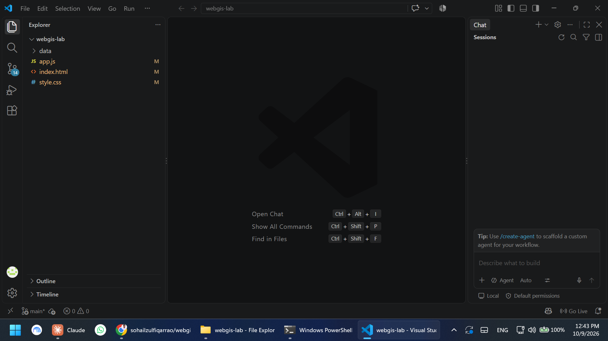

### Checkpoint 2 – Measurement table and versions A and D in QGIS
The completed measurement table, and the image of versions A and D drawn together, are in
[section 2.2](#22-measurements).

### Checkpoint 3 – Reading the GeoJSON as text

1. **Type of the outermost object:** `FeatureCollection`.
2. **Entries in the `features` array:** 160.
3. **Geometry type of the first feature:** `Polygon` (the first feature is Bagh, Azad Kashmir). The file also
   contains `MultiPolygon` features.
4. **Levels of square bracket before the first number:** three, `[[[73.69622,34.08025], ...`
   (the coordinates array, then the ring, then the position).
5. **Keys inside `properties`:** `district`, `province`, `pcode`, `pop_2023`, `area_km2`.

**First coordinate pair:** `[73.69622, 34.08025]`. The first number (73.7) is a longitude in the seventies and
the second (34.1) is a latitude in the thirties, so the order is longitude then latitude, which is the correct
GeoJSON order. The point lies inside Pakistan's range (longitude 61 to 77, latitude 24 to 37).

### Checkpoint 4 – Empty page on Live Server
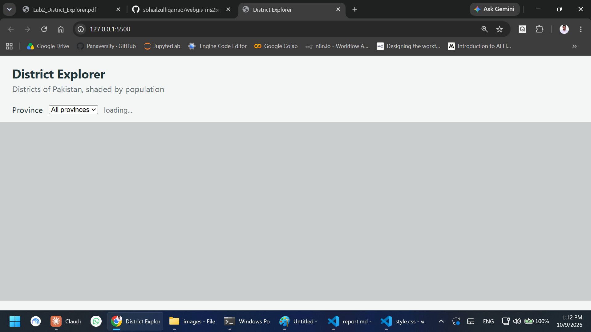

### Checkpoint 5 – Console
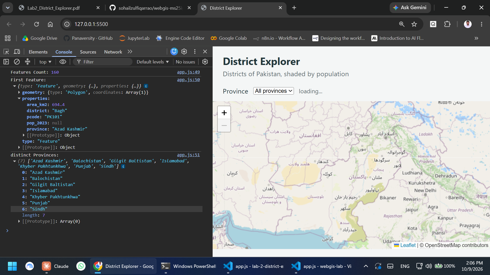

### Checkpoint 6 – Network tab

#### District GeoJson Size & Time
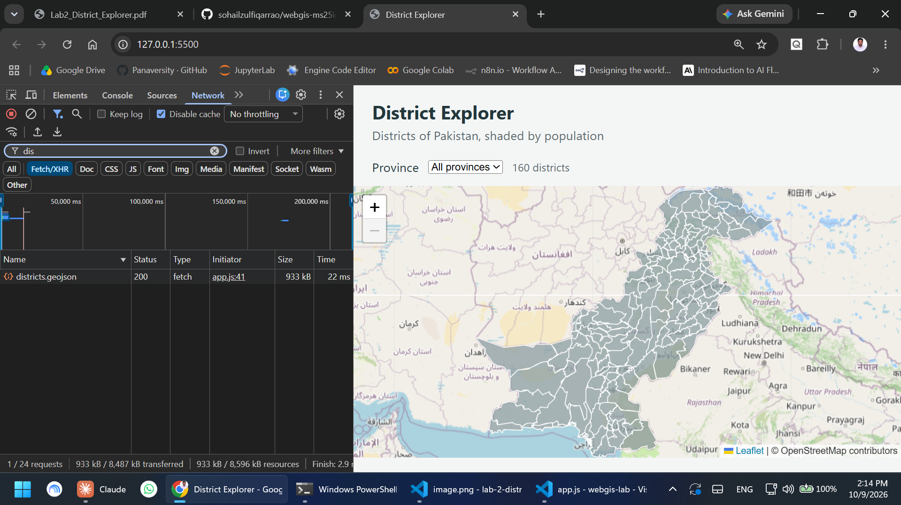
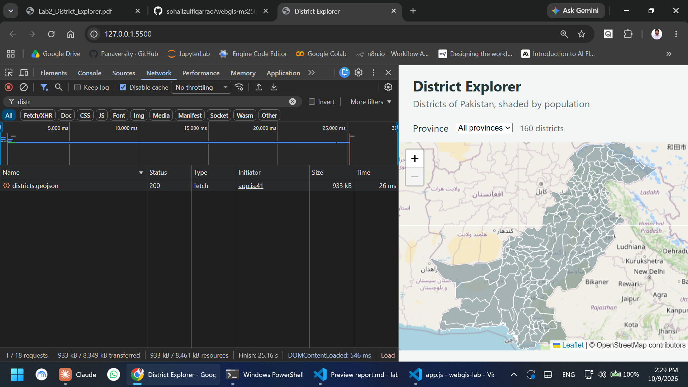
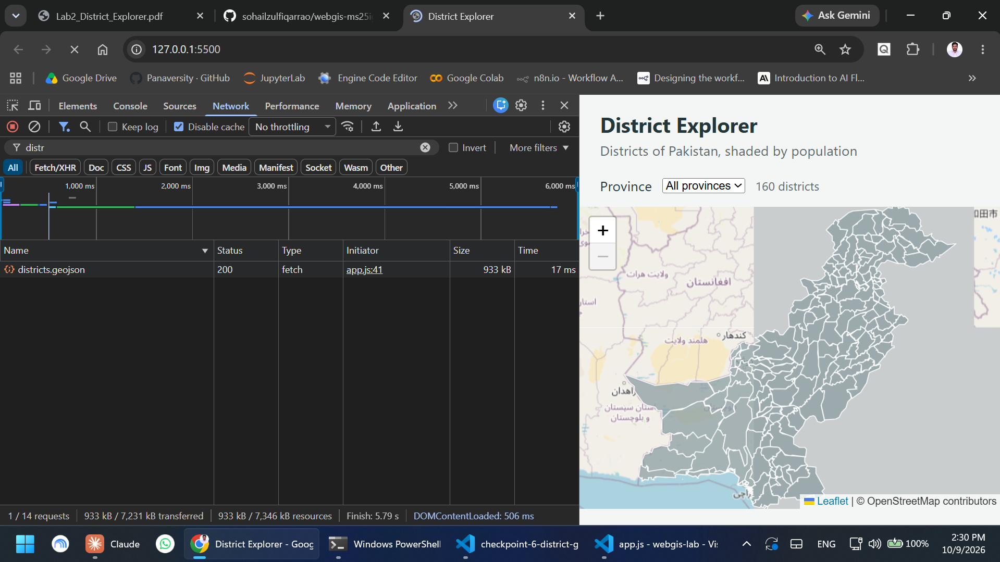
#### PNG Request Count
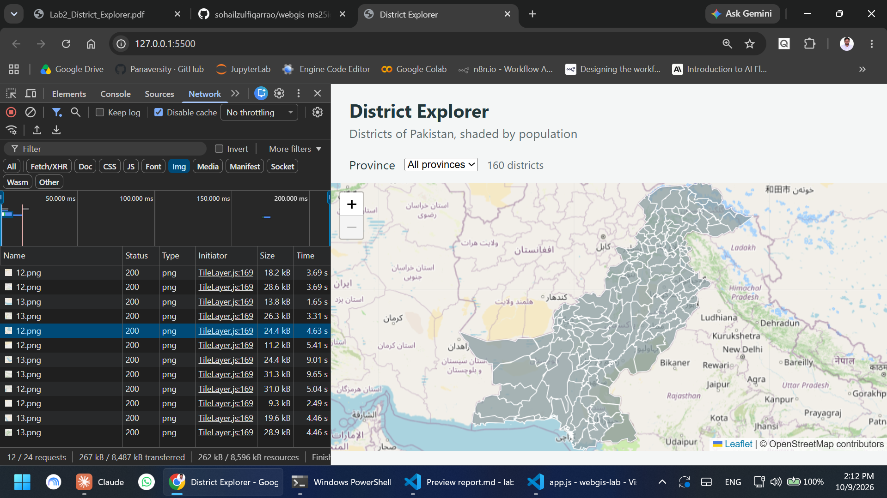

#### PNG Preview Tab
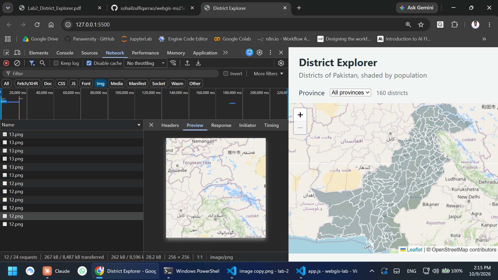

### Checkpoint 7 – Shaded map, legend and a popup
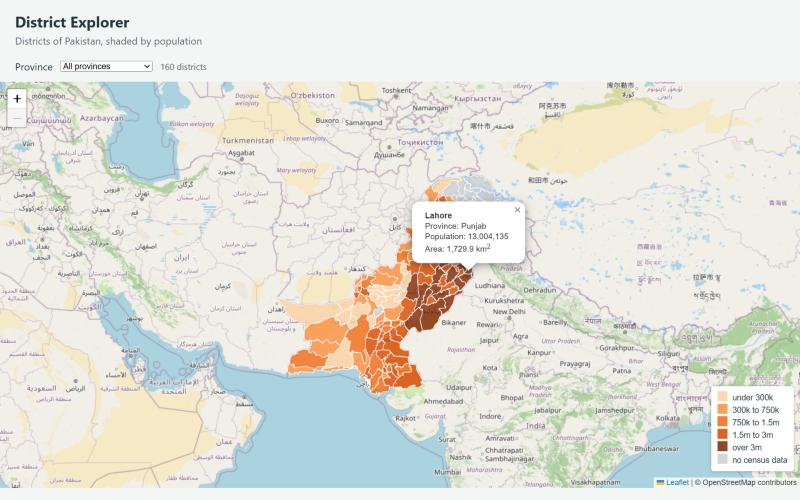

### Checkpoint 8 – Province filter (extension)
All provinces, 160 districts:

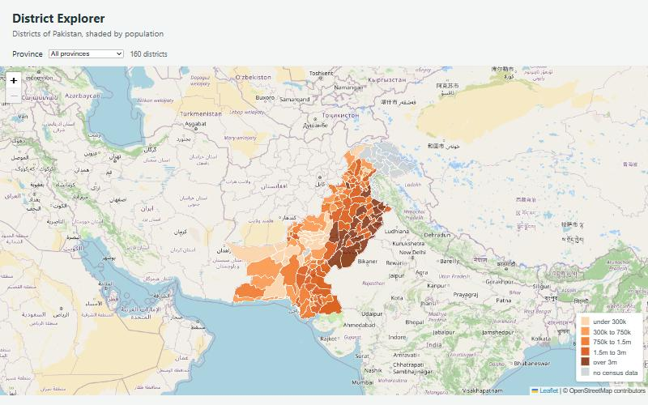

Khyber Pakhtunkhwa selected, 35 districts, map zoomed to the province:

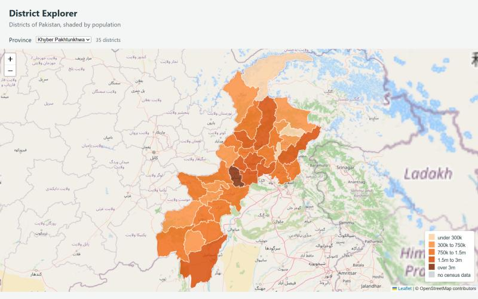

### Checkpoint 9 – Coordinate system comparison (extension)
See [section 5](#5-coordinate-system-comparison-part-10) for the table and the three answers.

---

## 2. File size table (Part 3)

### 2.1 What I was given

The layer is `pak_admin2` (districts) from the OCHA Common Operational Dataset bundle. I used `pak_admin2.shp`, not
its edge-matched twin `pak_admin2_em`.

- 160 polygon features, CRS WGS 84 (EPSG:4326), extent 60.8786 to 77.8340 °E and 23.6947 to 37.0894 °N.
- 26 fields. All are text (80 characters) except `valid_on` and `valid_to` (date) and `area_sqkm`, `center_lat`,
  `center_lon` (real numbers). The names are the original ones (`adm2_name`, `adm1_name`, `adm2_pcode`,
  `area_sqkm`) and there is no population field.
- The `districts.geojson` supplied for the lab has five properties (`district`, `province`, `pcode`, `pop_2023`,
  `area_km2`). `pop_2023` is stored as a number: 135 integers and 25 nulls, so there is no text-versus-number
  problem to trip the classification.

### 2.2 Measurements

All five adm2 components were added together for the shapefile row (`.shp` 4,090,564 + `.shx` 1,380 +
`.dbf` 283,906 + `.prj` 145 + `.cpg` 5), not the whole download. 

| Version | What was done | Size | % of A | Vertices |
|---|---|---|---|---|
| Shapefile | adm2 `.shp`, `.shx`, `.dbf`, `.prj`, `.cpg` added together | 4,376,000 bytes (4.38 MB) | 39.2 % | n/a |
| A | Straight conversion, default precision | 11,177,210 bytes (11.18 MB) | 100 % | 255,083 |
| B | Precision 5 | 6,170,047 bytes (6.17 MB) | 55.2 % | 255,070 |
| C | Simplified 0.001° (about 100 m), precision 5 | 1,171,352 bytes (1.17 MB) | 10.5 % | 44,773 |
| D | Simplified 0.01° (about 1 km), precision 5 | 334,891 bytes (0.33 MB) | 3.0 % | 9,596 |
| Supplied `districts.geojson` (served by the map) | LMS-prepared copy, 5 properties, precision 5 | 933,119 bytes (0.93 MB) | 8.3 % | 45,702 |

Notes on the method:

- C and D were made with QGIS's **Simplify** algorithm (`native:simplifygeometries`, Douglas-Peucker, tolerance 0.001° and
  0.01°) and then exported with precision 5. QGIS 4 has no "Preserve topology" checkbox; the algorithm preserves
  topology within each feature, but neighbouring districts are still simplified independently.
- Versions A to D keep all 26 attributes (80,030 to 80,084 bytes of the total), so the file sizes include them. The
  supplied file carries five properties (16,035 bytes), which is why it is a little smaller than C although it has
  about the same number of vertices (45,702 against 44,773). It is in effect the lab's version C with the population
  joined on, and it is what the map serves.

What each step buys:

- **A to B** (15 decimal places down to 5) saves 44.8 % of the size and changes nothing visible, since the fifth
  decimal is about 1.1 m.
- **B to C** (simplification at about 100 m) removes 82 % of the vertices and saves a further 81 % of the size.
- **D** (about 1 km) is 3.0 % of A.

### Checkpoint 2 – versions A and D drawn together

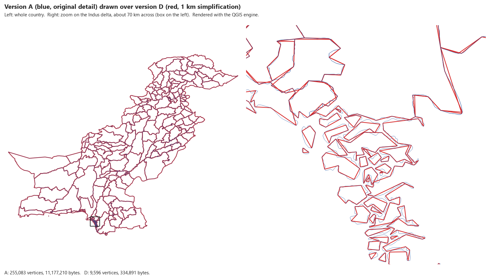

*Rendered with the QGIS engine (PyQGIS) from `districts_A.geojson` and `districts_D.geojson`. At country scale the two are indistinguishable; at the right-hand scale
(about 70 km across, the Indus delta) D has replaced the smooth channels and islands with straight segments.*

### Which is larger, the shapefile or the GeoJSON, and why

The published figures are 24.3 MB for the shapefile bundle and 27.7 MB for the same data as GeoJSON, so the GeoJSON is
about 14 % larger. For the adm2 layer on its own I measure a bigger gap: the straight GeoJSON (A) is **2.55 times** the
shapefile (11.18 MB against 4.38 MB). The reason is how a coordinate is stored. A shapefile writes each vertex as
two 8-byte binary numbers, 16 bytes (4,090,564 bytes of `.shp` for 255,083 vertices is 16.0 bytes each). GeoJSON
writes each number as decimal text, and at the default precision one vertex takes about 43.5 bytes (an
11.10 MB geometry for the same 255,083 vertices), plus the brackets, commas and the property keys repeated for every feature.
Text is a more verbose encoding of the same numbers, and in return it can be read by a person and by any browser.

### Formatting a copy to read it (Part 4.1)

The manual warns that formatting adds about 30 %. On the supplied file it was far more: pretty-printing with VS
Code's default 4-space indent gives 5,984,473 bytes (6.4 times the original) and a 2-space indent gives 3,552,459 bytes
(3.8 times), because every coordinate ends up on its own indented line. The formatted copy must therefore never
be the one served.

---

## 3. Load times and network measurements (Part 7.2)

Measured with the page served by a local web server on `127.0.0.1:5500`, cache bypassed
(`fetch(..., {cache: 'no-store'})`), no throttling.

| Item | Result |
|---|---|
| `data/districts.geojson` size on the wire | 933,119 bytes (the local server sends it uncompressed) |
| Time to fetch it, 3 runs | min 17 ms, **mean 21.3 ms**, max 26.0 ms |
| Requests on first load | 27 in total: 1 HTML, 2 CSS, 2 JavaScript, 1 GeoJSON, 21 map tiles |
| Requests ending in `.png` | 21 (all map tiles, at zoom 5) |
| One tile, e.g. `https://tile.openstreetmap.org/5/22/13.png` | 25,895 bytes, median 313.5 ms (5 runs, 215 to 428 ms) |
| Zoom level in that URL | the first number, `5` (then column `x = 22` and row `y = 13`) |
| DOMContentLoaded / load event | 34 ms / 221 ms (with tiles already cached, so these are lower bounds) |

A tile is a single 256 by 256 pixel PNG. Panning the map requests the new tiles that scroll into view and nothing else.

**GeoJSON compresses well.** Compressed with gzip level 6 the file is 299,042 bytes, 32 % of the raw size.
GitHub Pages compresses text responses, so the published page should transfer about that much (calculated, not
measured).

**Throttled load (Slow 3G).** The throttling menu is part of the DevTools interface, so I applied the same network
emulation it uses: Chrome 154 driven through the DevTools Protocol (`Network.emulateNetworkConditions`) with the
values from the DevTools source for its "Slow 3G" preset, which are 50,000 bytes per second down and up
(500 kbit/s × 0.8) and 2,000 ms of latency, with the cache disabled. The page came from a local server. The 25 map
tiles were answered from a local copy of one real 25,895-byte OpenStreetMap tile, so they still share the throttled
bandwidth without hammering the public tile server. Each case was loaded once.

"GeoJSON request" runs from the request being sent to the last byte arriving. "Districts on the map" is the time from
the start of navigation until the district count appears, which is when the layer is drawn. "Finish" is when the
last request ends.

| Case | GeoJSON on the wire | GeoJSON request | Districts on the map | Load event | Finish |
|---|---|---|---|---|---|
| Supplied file (C), no throttling | 933,303 B | 0.01 s | 0.66 s | 0.79 s | 0.80 s |
| Supplied file (C), **Slow 3G**, uncompressed (how Live Server serves it) | 933,303 B | **33.7 s** (2.0 s wait + 31.7 s download) | **39.2 s** | 30.0 s | 39.2 s |
| Supplied file (C), **Slow 3G**, gzip (how GitHub Pages serves it) | 294,751 B | **16.1 s** | **21.5 s** | 28.2 s | 30.2 s |
| `districts_A.geojson`, no throttling | 11,177,396 B | 0.07 s | 0.97 s | 0.97 s | 1.00 s |
| `districts_A.geojson`, **Slow 3G**, uncompressed | 11,177,396 B | **238.6 s** (2.1 s wait + 236.6 s download) | **244.3 s** | 29.7 s | 243.9 s |
| `districts_A.geojson`, **Slow 3G**, gzip | 3,655,082 B | **88.2 s** (2.1 s wait + 86.1 s download) | **93.8 s** | 29.9 s | 93.6 s |

What the numbers show:

- On Slow 3G the simplified file needs 33.7 s as Live Server sends it and 16.1 s gzipped, and the map has no districts
  until it arrives. Version A would take 238.6 s uncompressed (about four minutes) and 88.2 s gzipped, so the
  simplified file is 7.1 times faster uncompressed and 5.5 times faster gzipped. This is the practical reason for
  simplifying before publishing.
- Compression alone halves the time for the simplified file (33.7 s to 16.1 s) and cuts version A by 63 %. GitHub Pages
  compresses text, so the published page should be faster than the Live Server numbers.
- The load event (about 30 s in every Slow 3G row) does not wait for the GeoJSON, because it is fetched by JavaScript
  after the page loads. It only reflects Leaflet and the tiles, so on this page the load time understates what the user
  actually waits for; the "districts on the map" column is the better measure.
- The 31.7 s download for the 933,303-byte file is slower than 933,303 / 50,000 = 18.7 s because the Leaflet script and
  the 25 tiles share the same 50,000 bytes per second. Version A, which is far larger than everything else on the
  page, comes close to its arithmetic figure (11,177,396 / 50,000 = 223.5 s against 236.6 s measured).

These figures come from the emulation, not from the DevTools panel itself. The same test can be repeated in DevTools
with the Network tab open, Disable cache ticked and Throttling set to Slow 3G.

---

## 4. Classification (Part 8)

**Breaks used:** 300,000 / 750,000 / 1,500,000 / 3,000,000, giving five classes plus a separate grey class for
districts with no census value.

| Class | Districts |
|---|---|
| under 300k | 20 |
| 300k to 750k | 23 |
| 750k to 1.5m | 28 |
| 1.5m to 3m | 40 |
| over 3m | 24 |
| no census data (grey) | 25 |

**Why these breaks.** District populations are heavily skewed (from 127,571 in Harnai to 13,004,135 in Lahore, median
1,357,890), so an equal-interval split with a step of about 2.6 million would put 109 of the 135 districts into one
class and make the map nearly uniform, whereas roughly doubling breaks spread the districts across all five classes.

The 25 grey districts are the 14 in Gilgit Baltistan, the 10 in Azad Kashmir (not covered by the 2023 census) and
Lehri in Balochistan (not listed separately in the census tables).

---

## 5. Coordinate system comparison (Part 10)

Method: the 160 districts were reprojected from EPSG:4326 to EPSG:3857 and to EPSG:32643 and the **planar**
area of each polygon was computed in that system (the same as the Field Calculator expression `$area / 1000000`
when the project ellipsoid is set to none). As an independent check, the geodesic area on the WGS 84 ellipsoid was
also computed. Five districts were taken from the south to the north, all east of 70°E so that UTM zone 43N
(central meridian 75°E) is a fair measuring system for them.

| District | Latitude | 3857 km² | UTM 43N km² | % difference | Geodesic km² | 1 / cos²(lat) |
|---|---|---|---|---|---|---|
| Tharparkar | 24.78° | 23,985.1 | 19,785.4 | 21.2 % | 19,684.0 | 1.213 |
| Rahim Yar Khan | 28.41° | 16,672.2 | 12,900.3 | 29.2 % | 12,849.3 | 1.293 |
| Lahore | 31.47° | 2,384.7 | 1,728.4 | 38.0 % | 1,729.6 | 1.375 |
| Haripur | 34.00° | 2,849.7 | 1,953.8 | 45.9 % | 1,953.5 | 1.455 |
| Hunza | 36.58° | 17,745.0 | 11,411.2 | 55.5 % | 11,419.7 | 1.551 |

`% difference = (3857 − UTM) / UTM × 100`. Latitude is the district centroid.

### Answers

1. **Does the percentage difference grow or shrink northward?** It grows, steadily: 21.2 % at 24.8°N, 29.2 %,
   38.0 %, 45.9 %, and 55.5 % at 36.6°N. Web Mercator stretches every direction by 1 / cos(latitude), so the
   inflation increases toward the poles.
2. **Predicted versus measured.** For Lahore (31.47°N), cos² = 0.7272 and 1 / cos² = 1.375, a predicted
   inflation of 37.5 %. The measured ratio of the two areas is 1.380 (38.0 %). The agreement is within 0.5
   percentage points, and the same holds in every row (for example Hunza 1.551 predicted, 1.555 measured). The
   small gap is expected because the formula uses one latitude while a district spans a range of latitudes.
   The lecture's claim that Web Mercator areas are "about 40 % too large" at this latitude holds: 38 % at Lahore,
   46 % at 34°N.
3. **Which figure goes in a report?** The UTM figure. Web Mercator is conformal, not equal-area, and its error is
   large and latitude dependent (it overstates the geodesic area by 21 % to 55 % across the 160 districts), so it
   must not be used for any area or distance. The UTM figures are
   within 0.12 % of the geodesic area for all 66 districts east of 72°E.
   **Caveat:** EPSG:32643 is only good near its central meridian. Over all 160 districts the worst UTM 43N error
   is 3.55 % (Gwadar, far to the west), so west of about 70°E zone 42N (EPSG:32642) or an equal-area projection
   should be used.

**QGIS note.** `$area` follows the project's ellipsoid setting. If the project ellipsoid is WGS 84, `$area`
returns the ellipsoidal area for both layers and the two numbers come out the same. To reproduce the planar
comparison above in QGIS, set the project ellipsoid to "None / Planimetric" first (Project Properties, General,
Measurements).

---

## 6. Questions

**1. Version D is far smaller than version A. Give one situation in which version D would be the wrong choice.**
When the geometry is used at a large scale or to measure. A 1 km tolerance moves boundaries by up to about a
kilometre, so D is wrong for a map zoomed in to a single district or tehsil (borders would look blocky and would not
line up with roads, rivers or imagery), and wrong for computing an area, a boundary length or an overlay, because
all of those would be computed on displaced geometry.

**2. The page makes one request for your GeoJSON file and dozens for tiles. Explain the difference in how those two kinds of data reach the browser.**
The GeoJSON is one vector file that JavaScript requests explicitly with `fetch`, downloads whole (933,119 bytes
here), parses into an object in memory, and then draws and styles itself in the browser, so every feature stays
queryable and clickable. Tiles are pre-rendered 256 by 256 pixel raster pictures that the server cuts in advance
along a z/x/y grid. Leaflet requests only the tiles that cover the current view, as separate parallel image requests
(21 at first load, about 26 KB each), and requests more as the user pans or zooms. A tile is just a picture, so it
carries no attributes.

**3. Why does the map container need a height when the heading does not?**
An element's height normally comes from its content. A heading contains text, so it takes the height of that text.
The `
` starts empty, and Leaflet's panes are positioned absolutely, so they add nothing to the
parent's height. The div therefore stays zero pixels tall and the map is drawn into a box you cannot see, with no
error. The `#map` rule gives it an explicit `height: calc(100vh - 150px)`.

**4. `draw` removes the existing layer before adding a new one. What would go wrong if it did not?**
`L.geoJSON(...).addTo(map)` adds a layer, it does not replace one. Without `removeLayer`, each choice in the
drop-down would add another layer on top of the earlier ones. The filter would appear to do nothing, because the
"all provinces" layer would still be drawn underneath the selected province, and the old layers would keep
their popups and event handlers, using memory and slowing the map down with every change.

**5. A classmate's districts all appear in the same colour. List two possible causes and how you would tell them apart.**
(a) The population values cannot be read as numbers (a thousands separator, a stray space or text such as "NA").
Every comparison is false, so every district falls through to the last line and gets the palest class,
`#fdd0a2`. Check with `typeof districts.features[0].properties.pop_2023`, which prints `string`, and look
at the field type in the QGIS attribute table.
(b) The field name does not match (for example the code reads `pop_2023` but the file has another name). The value is
`undefined`, which `colourFor` treats as missing, so every district is grey, `#c9cfd1`. Check with
`Object.keys(districts.features[0].properties)`. The two cases are told apart first by the colour (pale orange
against grey), and then by those two console checks.

**6. You open the page by double-clicking `index.html` instead of using Live Server. The basemap appears but the districts do not. Explain why.**
The page is then loaded from a `file:///` address. The basemap tiles are ordinary `` loads from
`https://tile.openstreetmap.org`, which a page from the file system is allowed to make. The districts are
requested with `fetch('data/districts.geojson')`, and browsers block `fetch` of local files from a `file://` page
(the origin is treated as opaque, and the request is refused as a cross-origin request). The promise rejects, `loadData`
stops before `draw` runs, and the console shows a CORS or "Failed to fetch" error that does not mention the real cause.
Serving the folder over HTTP, as Live Server does at `127.0.0.1:5500`, makes it a normal same-origin request.

---

## 7. Publishing

- Repository: https://github.com/sohailzulfiqarrao/webgis-ms25igis-578135 (this lab is in `lab-2-district-explorer/`)
- Live page (GitHub Pages, branch `main`, folder `/`): https://sohailzulfiqarrao.github.io/webgis-ms25igis-578135/lab-2-district-explorer/
- All labs: https://sohailzulfiqarrao.github.io/webgis-ms25igis-578135/
- Commit history: `git log --oneline`

---

## Additional Task – optional exercises from the manual

### 1. Second basemap and a layer control

`L.control.layers` switches between **OpenStreetMap** and **Satellite (Esri)** (World Imagery), using the layer button
at the top right of the map.Esri's tile URL is `{z}/{y}/{x}`, not `{z}/{x}/{y}`.
**Check:** after switching, 24 of 24 Esri tiles loaded and no OpenStreetMap tiles remained.

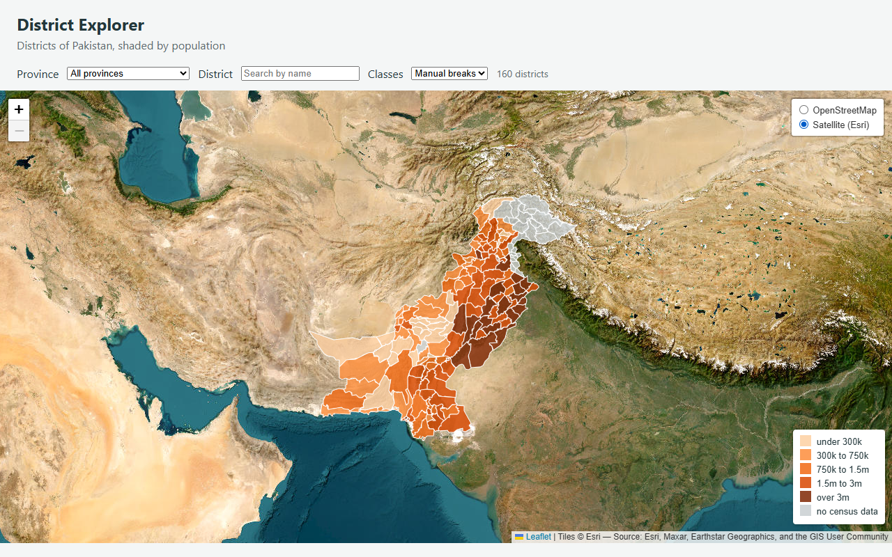

### 2. Highlight a district on mouseover

`mouseover` sets the district's outline `weight` to 3 (and a darker colour) and brings it to the front; `mouseout`
calls `layer.resetStyle`. **Check:** the outline weight went 1, then 3 while hovered, then back to 1.

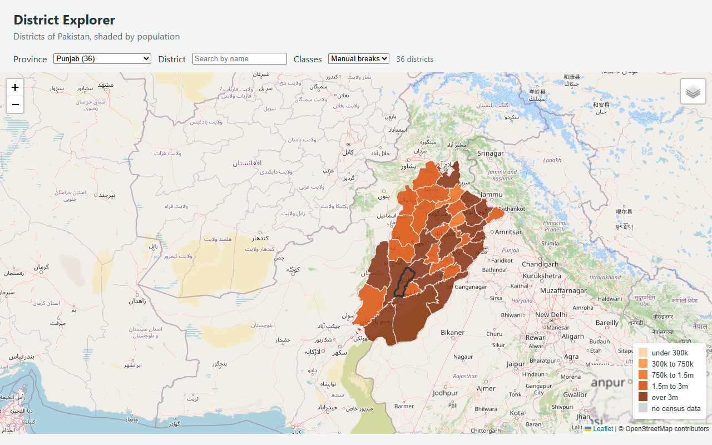

### 3. Text box that filters by name

The **District** box filters as the user types (case-insensitive, matching anywhere in the name) and combines with the
province drop-down; both call one function, `applyFilters()`. **Check:** "pur" gives 9 districts, "LAHORE" gives 1,
"zzzz" gives 0 (an empty map, no error), and Sindh plus "pur" gives Khairpur, Mirpur Khas and Shikarpur.

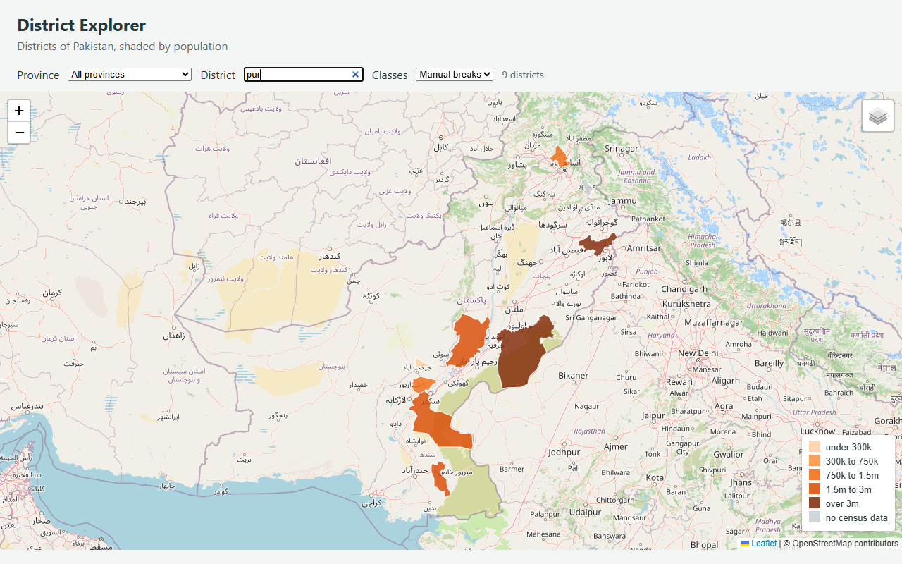

### 4. Drop-down sorted by district count

`fillProvinceList` counts the districts per province and sorts by that count, largest first and alphabetically for ties.
The count is shown in each label: Punjab (36), Balochistan (35), Khyber Pakhtunkhwa (35), Sindh (29),
Gilgit Baltistan (14), Azad Kashmir (10), Islamabad (1).

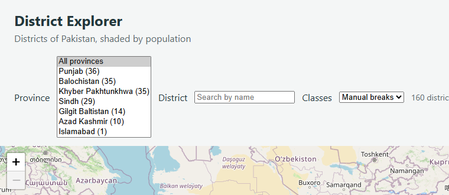

### 5. Quantile breaks instead of manual ones

`quantileBreaks()` sorts the 135 population values and cuts them into five classes (linear interpolation, rounded to
the nearest 1,000). The **Classes** drop-down switches between the two without moving the map, and the legend rewrites
itself. The manual breaks remain the default, so the classification described in section 4 still applies.

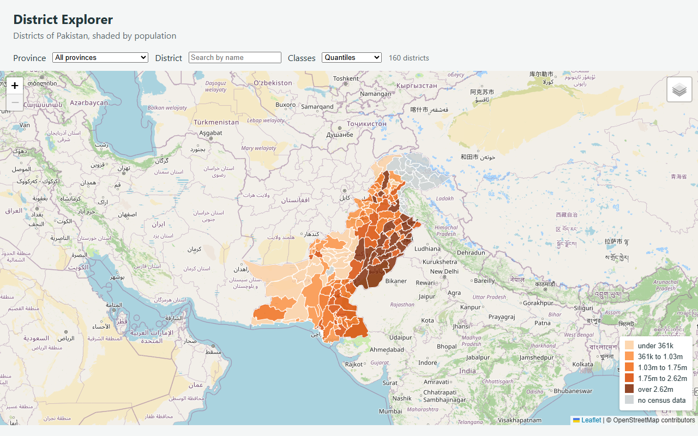

| Class | Manual breaks | Districts | Quantile breaks | Districts |
|---|---|---|---|---|
| 1 | under 300k | 20 | under 361k | 27 |
| 2 | 300k to 750k | 23 | 361k to 1.03m | 27 |
| 3 | 750k to 1.5m | 28 | 1.03m to 1.75m | 27 |
| 4 | 1.5m to 3m | 40 | 1.75m to 2.62m | 27 |
| 5 | over 3m | 24 | over 2.62m | 27 |
| no census data | grey | 25 | grey | 25 |

Quantiles put the same number of districts in every class, so the colours are evenly spread, but the break values
(361,000 and so on) are awkward numbers and the classes are very uneven in width. The manual breaks are easier to
read in a legend, which is why they stay the default.
