# Web GIS Lab 3 – District Dashboard: Report

| | |
|---|---|
| **Name** | Sohail Zulfiqar |
| **Registration ID** | 578135 |
| **Email** | szulfiqar.ms25igis@student.nust.edu.pk |
| **Program** | MS GIS & RS – 2025 |
| **Subject** | Web GIS (Dr. Shahid Nawaz Khan) |
| **Repository** | https://github.com/sohailzulfiqarrao/webgis-ms25igis-578135 (folder `lab-3-district-dashboard`) |
| **Live page** | https://sohailzulfiqarrao.github.io/webgis-ms25igis-578135/lab-3-district-dashboard/ |

## 1. Checkpoint screenshots

### Checkpoint 1 – Project folder
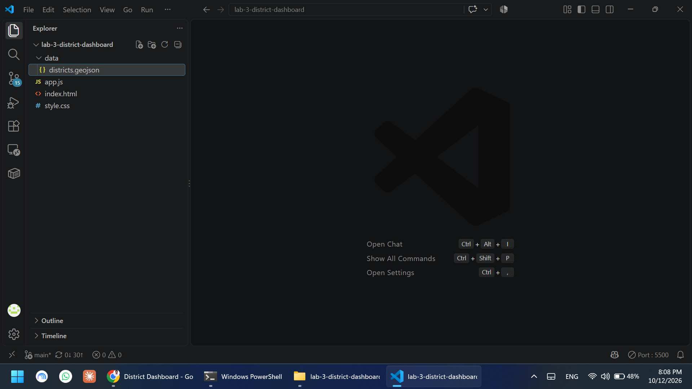

### Checkpoint 2 – Centroid outside its district
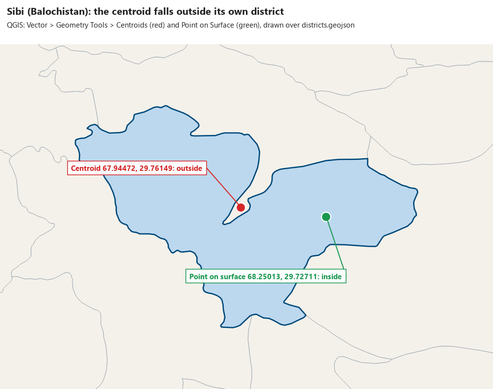

The district is **Sibi**, Balochistan: its centroid (67.94472, 29.76149) lies outside its boundary, while its point on surface (68.25013, 29.72711) lies inside. `district_points.geojson` (Point on Surface, EPSG:4326, `COORDINATE_PRECISION` 5) is **35,738 bytes with 160 features**, and the points keep their district's attributes.

### Checkpoint 3 – Esri tile request
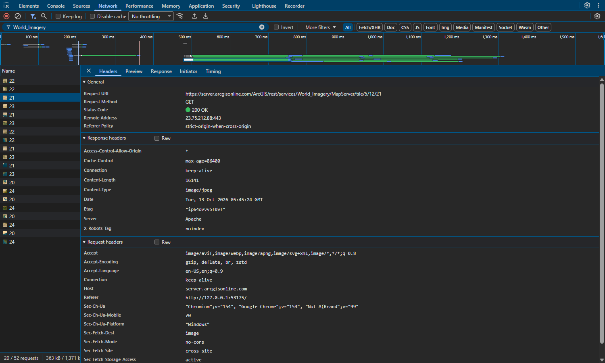

The request is `https://server.arcgisonline.com/ArcGIS/rest/services/World_Imagery/MapServer/tile/5/12/21`. The Esri template is `…/tile/{z}/{y}/{x}`, so in this URL the zoom is **5**, the **row** is **12** and the **column** is **21**. The attribution in the corner changes with the basemap (`Tiles © Esri` for imagery, `© OpenStreetMap contributors` for OpenStreetMap).

The manual's default basemap, CARTO Positron, now answers every tile with "API KEY REQUIRED", so the quiet grey basemap is Esri's Light Gray Canvas instead.

### Checkpoint 4 – Density map, legend and layer control
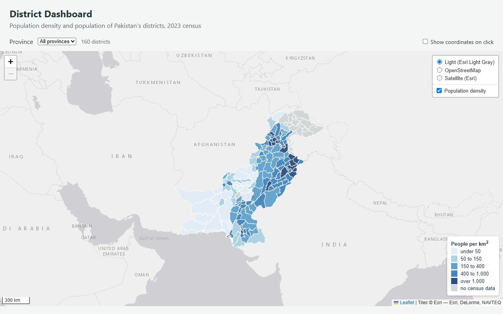

With the manual's breaks, the 135 districts with census data fall 20, 18, 34, 41 and 22 into the five classes, and 25 have no data.

### Checkpoint 5 – Highlight, tooltip and info panel
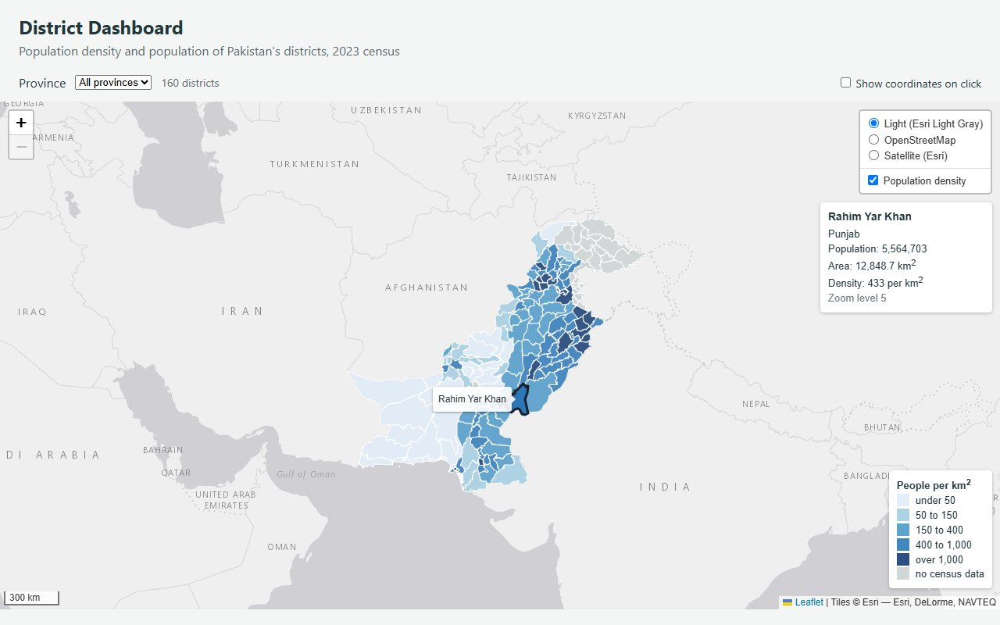

### Checkpoint 6 – Circles above the polygons, and the NUST overlay

NUST overlay at zoom 5 and zoom 10:

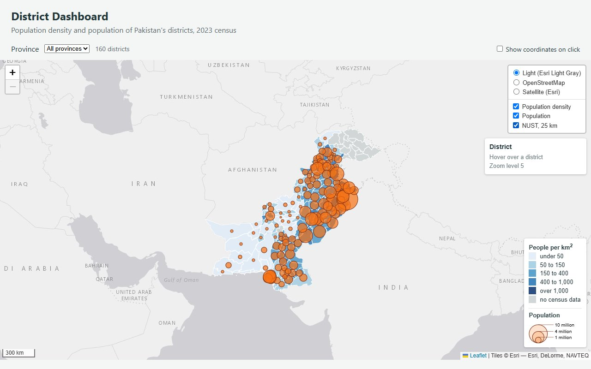

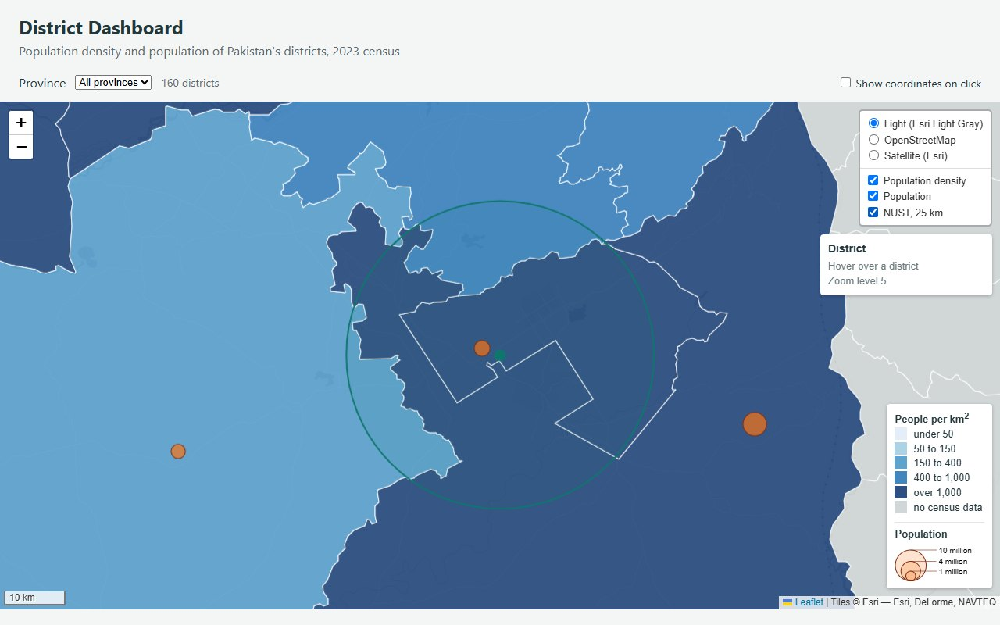

At zoom 5 the 25 km `L.circle` is 6.1 px in radius and the `L.circleMarker` is 6 px, so they look the same. At zoom 10 the circle is 196.7 px, which matches the scale bar (10 km = 79 px, so 25 km is about 198 px), while the marker is still 6 px. The info panel in the zoom 10 image still says zoom 5 because the `zoomend` handler is only added in Part 7.2.

### Checkpoint 7 – Coordinates on the sea
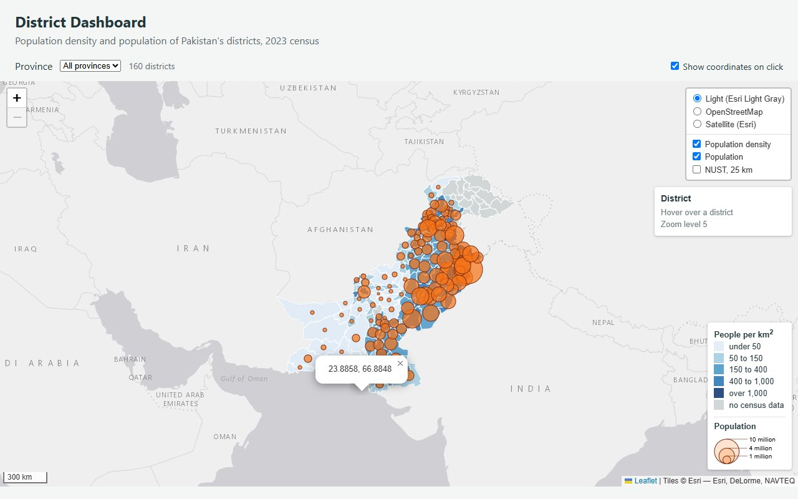

1. **Sea, then a district.** Clicking the sea south of Karachi opened a popup with `23.9662, 66.7969`. Clicking Rahim Yar Khan opened a coordinate popup (`27.9168, 70.7959`) *and* zoomed the map from level 5 to 8: both handlers ran, because a click on a polygon also reaches the map.
2. **Legend.** With the box ticked, clicking the legend opened no popup (0 open). Without the `disableClickPropagation` line it opened one (`28.9216, 93.3838`): the click went through the legend to the map beneath.
3. **Unticked.** Clicking the sea opened no popup (0 open), because `map.off` removed the handler.

### Checkpoint 8 – One province, overlays still switch
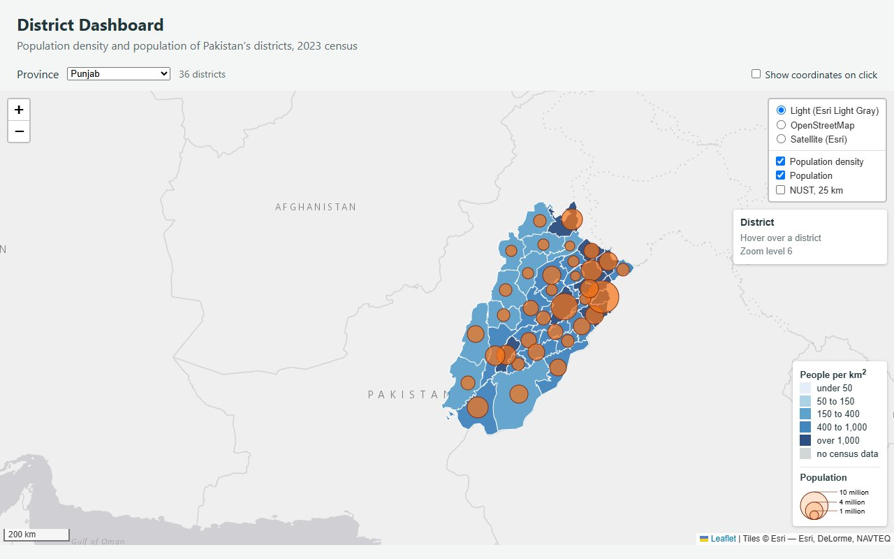

With Punjab selected (36 districts, 36 circles) I switched each overlay off and on in the control, and each hid and showed its rebuilt layer. **Gilgit Baltistan** reads 14 districts but shows no circles (0), because none of its districts has a census value: `hasPopulation` drops all 14 before drawing. The dashboard should say so, for example "no census data for this province", because an empty Population overlay looks like a bug.

### Checkpoint 9 – SVG or canvas

| | SVG | Canvas |
|---|---|---|
| `draw(all)`, median of five loads, ms | **64.4** (loads: 100, 52, 52.1, 65.5, 64.4) | **57.7** (loads: 57.7, 68.2, 54.9, 82.9, 48) |
| Elements inside `leaflet-overlay-pane` | 162 (an `<svg>`, a `<g>` and 160 paths) | 1 (one `<canvas>`) |
| Hover highlight still works? | Yes | Circles only: the districts no longer highlight |
| Can you inspect one district in Elements? | Yes, one `<path>` per district | No, all districts are pixels in one `<canvas>` |

#### SVG --> Elements Tab --> Leaflet-Pane
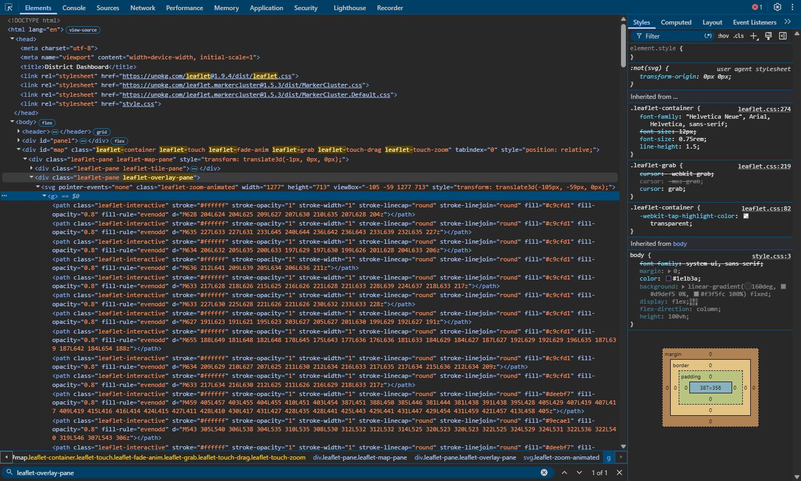

#### Canvas --> Elements Tab --> Leaflet-Pane
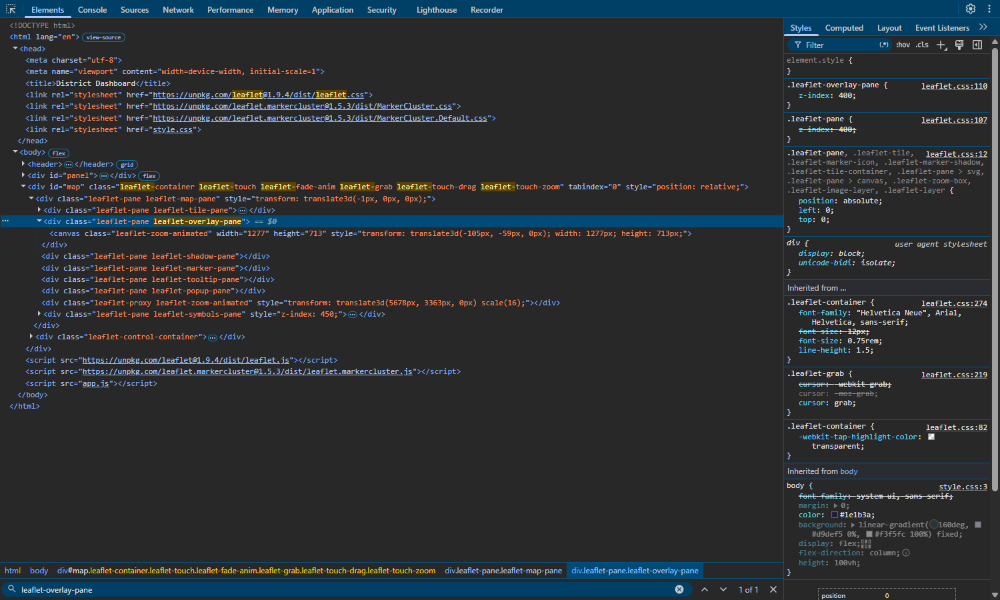

**Why hover fails on canvas.** Each pane gets its own canvas. The symbols pane's canvas sits above the districts' canvas and takes every pointer event, so only the circles respond (their tooltip still works).

**Tehsils (administrative level 3).** I would expect canvas to win clearly there. SVG makes one DOM element per feature, so several times more features with more vertices each means thousands of elements for the browser to lay out and repaint on every pan and zoom, and `draw` time and memory grow with them. A canvas draws the same shapes as pixels in one element, so its cost grows much more slowly. With only 160 districts the difference here is small (64.4 ms against 57.7 ms).

---

## 2. Questions

**1. Lab 2 shaded districts by population. Name one large, thinly populated district and one small, crowded one, and explain how each would mislead on the Lab 2 map.**
*Khuzdar* is about 30,955 km² with 997,214 people, only 32 per km². Its population falls in a mid class (750k to 1.5m), so a huge polygon is shaded as if it were populous, and the map repeats its area instead of its crowding. *Central Karachi* is 65 km² with 3,822,325 people, about 58,700 per km², the densest district. It gets the same darkest class as Lahore (13 million, 7,517 per km²) and is too small to see, so the map hides how crowded it is.

**2. `radiusFor` takes a square root. What would the map suggest about Lahore against a district of 3 million if it did not?**
Lahore has 4.3 times the people (13,004,135 against 3,000,000). If the radius followed population, its circle would have 4.3 times the radius and about 19 times the area, so it would look 19 times as populous. With the square root the area ratio is 4.3, matching the data.

**3. Why does the layer control hold `districtGroup` rather than the `L.geoJSON` layer itself?**
`draw` builds a new `L.geoJSON` layer every time the province changes and throws the old one away. A control pointing at a discarded layer would switch nothing. The group stays in place and only its contents are replaced, so the control keeps working.

**4. What would go wrong if the circles were drawn in `overlayPane` instead of the `symbols` pane?**
Polygons and circles would share a pane and be stacked in the order they were added. Hovering a district calls `bringToFront`, which would lift that polygon over the circles, so its circle would disappear under it, and it would stay hidden after the pointer left. Moving over the map would progressively cover the circles.

**5. Why can `map.off` remove `showCoordinates`, when it could not remove an anonymous function passed to `map.on`?**
`map.off('click', showCoordinates)` removes the handler by finding the same function object that was passed to `map.on`. An anonymous function has no name or variable, and writing the same code again creates a different object, so there is nothing to pass to `off`.

**6. On the NUST overlay, which circle would you use to show a 25 km evacuation zone, and which to mark the campus on a national map? Why?**
`L.circle` for the evacuation zone: its radius is in metres, so it covers the true 25 km at every zoom and can be measured against the scale bar. `L.circleMarker` for the campus: its radius is in pixels, so the dot stays visible at national zoom, where a 25 km circle shrinks to about 6 px.

---

## 3. Publishing

- Repository: https://github.com/sohailzulfiqarrao/webgis-ms25igis-578135 (this lab is in `lab-3-district-dashboard/`)
- Live page: https://sohailzulfiqarrao.github.io/webgis-ms25igis-578135/lab-3-district-dashboard/
- Lab 2 still works at its own address: https://sohailzulfiqarrao.github.io/webgis-ms25igis-578135/lab-2-district-explorer/

---

## Additional Task – optional exercises from the manual

### 1. Marker clusters on a separate overlay
Leaflet.markercluster draws the 160 points as clustered markers on a "Points (clustered)" overlay, which is off by default and rebuilt with the province filter. **Check:** at zoom 5 it shows 5 clusters (sizes 73, 49, 19, 13, 6 and so on), and at zoom 12 around Lahore they split into single markers.

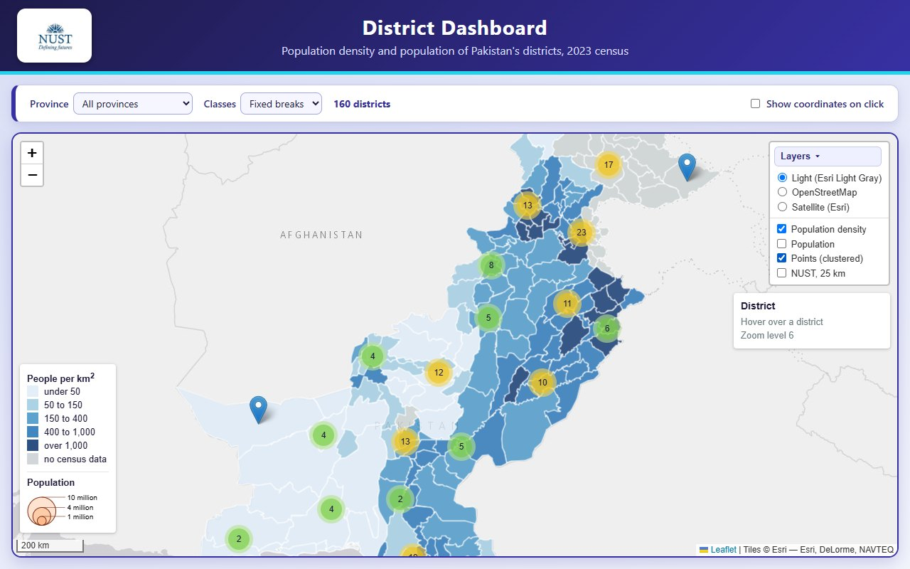

### 2. Density labels above zoom 8
`zoomend` adds a permanent tooltip with the density at each district's point on surface above zoom 8 and removes them at zoom 8 or below. **Check:** 0 labels at zoom 8 and 135 at zoom 9, one for each district with census data (Lahore reads 7,517).

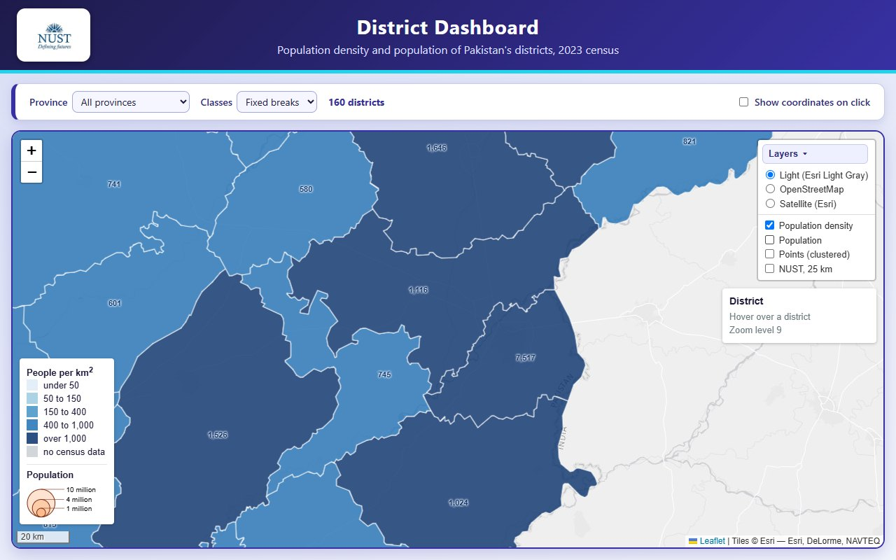

### 3. Remember the view
`moveend` saves the centre and zoom in `localStorage`, and the next visit restores them after the first draw. **Check:** after setting the view to zoom 8 near Punjab and reloading, the map came back at zoom 8, centre 31.2, 72.4. With storage blocked the page still loads (160 districts, 0 errors), because every call is in a `try` block.

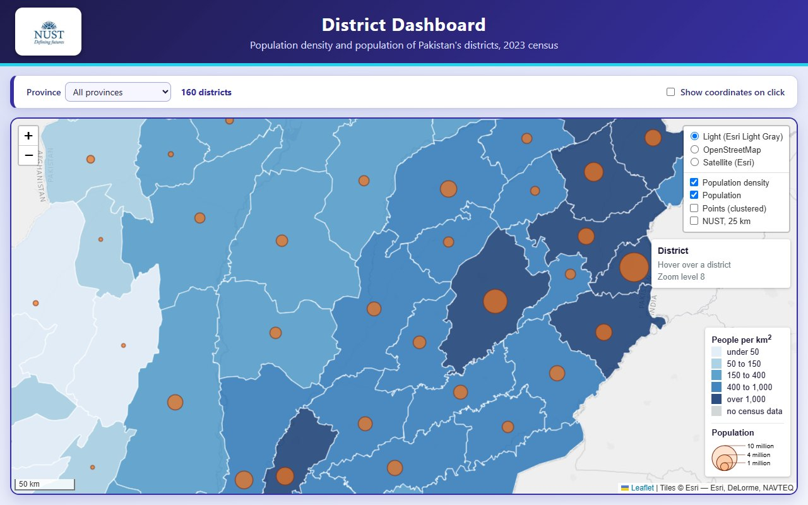

### 4. Quantile breaks
`quantileBreaksOf` computes five equal-count classes from the 135 densities, and the Classes drop-down restyles the layer and rewrites the legend. The fixed breaks stay the default. **Check:** fixed breaks 50, 150, 400, 1000; quantile breaks 74, 275, 456, 869, which put 27, 27, 27, 27, 27 districts in the five classes; the choice survives a province change.

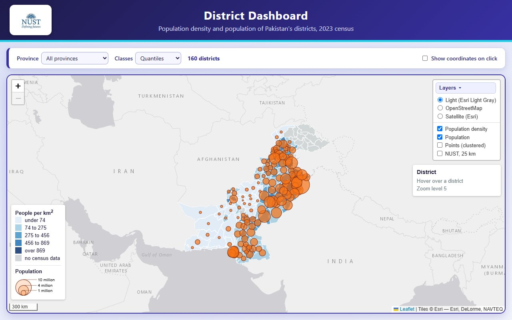

### 5. Layout fix: legend and layer control
Testing on a short window showed the bottom-right legend covering the last row of the layer control and part of the info panel, and the layer control could not be collapsed (the manual keeps it open). The legend now sits at the bottom left and scrolls if the map is short, and a Layers button collapses and reopens the control; it starts collapsed on small screens. **Check:** I measured the controls at nine window sizes, open and in their default state, and none of them overlaps.

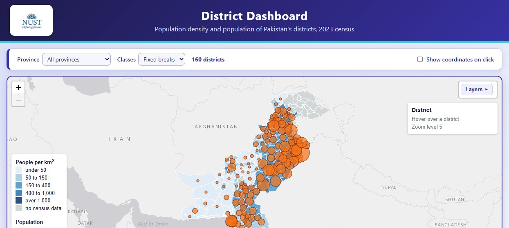
