# Web GIS Lab 4 – GeoDjango with PostGIS: Report

| | |
|---|---|
| **Name** | Sohail Zulfiqar |
| **Registration ID** | 578135 |
| **Email** | szulfiqar.ms25igis@student.nust.edu.pk |
| **Program** | MS GIS & RS – 2025 |
| **Subject** | Web GIS (Dr. Shahid Nawaz Khan) |
| **Repository** | https://github.com/sohailzulfiqarrao/webgis-ms25igis-578135 (folder `lab-4-GeoDjango_Getting_Started`) |
| **Map snapshot** | https://sohailzulfiqarrao.github.io/webgis-ms25igis-578135/lab-4-GeoDjango_Getting_Started/web/ (a static copy; the app itself runs locally) |

## 1. Checkpoint screenshots

### Checkpoint 1 – Django install page
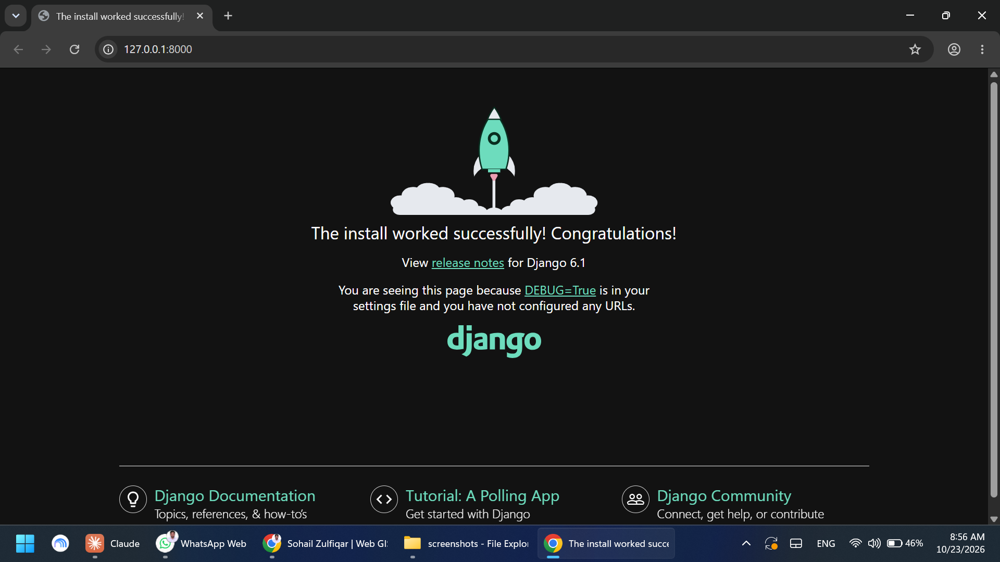

```
python -m django --version
6.1.2
```

### Checkpoint 2 – pgAdmin and PostGIS
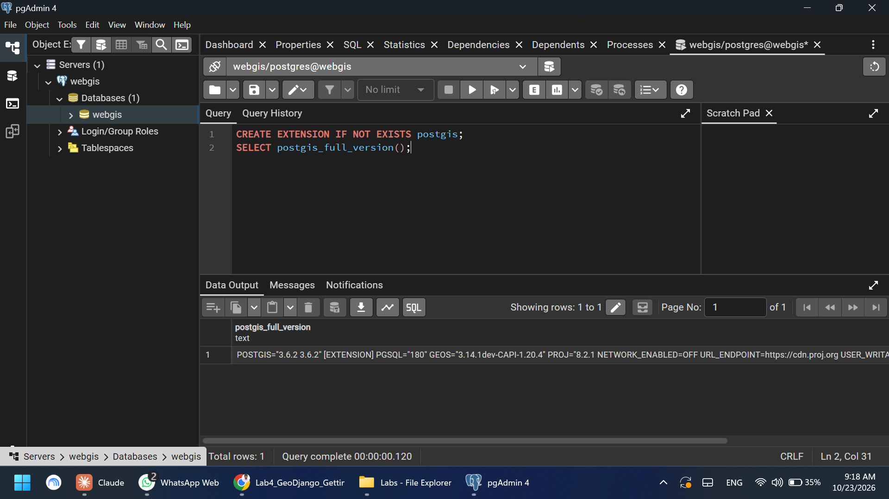

PostgreSQL 18.3 and PostGIS 3.6.2 were already on this machine, so parts 2.1 and 2.2 were not repeated. I created the `webgis` database and enabled PostGIS (the statement in the screenshot uses `IF NOT EXISTS` because the extension was already there). pgAdmin has its own server entry, `webgis`, limited to that one database.

### Checkpoint 3 – Django connected to PostGIS
```
python manage.py shell -c "from django.contrib.gis import gdal, geos; print(gdal.gdal_version(), geos.geos_version())"
b'3.13.3' b'3.15.0-CAPI-1.21.0'

python manage.py check
System check identified no issues (0 silenced).

python manage.py migrate
  Applying contenttypes.0001_initial... OK
  ... (18 migrations: admin, auth, contenttypes, sessions)
  Applying sessions.0001_initial... OK
```

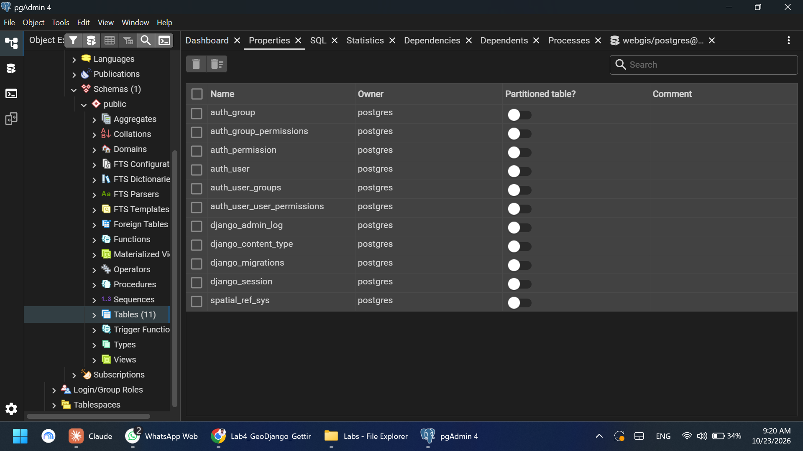

Django's own tables sit beside PostGIS's `spatial_ref_sys`.

### Checkpoint 4 – The model and its SQL
```
python manage.py sqlmigrate districts 0001
CREATE TABLE "districts_district" ("id" bigint NOT NULL PRIMARY KEY GENERATED BY DEFAULT AS IDENTITY,
  "name" varchar(100) NOT NULL, "province" varchar(50) NOT NULL, "pcode" varchar(10) NOT NULL UNIQUE,
  "pop_2023" integer NULL, "area_km2" double precision NOT NULL, "geom" geometry(MULTIPOLYGON,4326) NOT NULL);
CREATE INDEX "districts_district_pcode_affbafd9_like" ON "districts_district" ("pcode" varchar_pattern_ops);
CREATE INDEX "districts_district_geom_4bac833c_id" ON "districts_district" USING GIST ("geom");
```

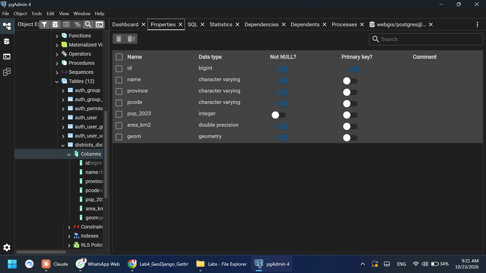

`geom` is a real PostGIS column (MultiPolygon, EPSG:4326) with a GiST index that GeoDjango added by itself. Only `pop_2023` accepts null.

### Checkpoint 5 – Loading the districts
```
python manage.py shell -c "from districts import load; load.run()"
districts : 160 features, Unknown geometry
160 districts saved
```

The layer type is Unknown because the file mixes 152 Polygons and 8 MultiPolygons.

```
>>> District.objects.count()
160
>>> District.objects.filter(province="Sindh").count()
29
>>> District.objects.filter(pop_2023__isnull=True).count()
25
>>> lahore = District.objects.get(name="Lahore")
>>> lahore.pop_2023
13004135
>>> lahore.geom.geom_type
'MultiPolygon'
>>> lahore.geom.num_coords
238
```

### Checkpoint 6 – The admin panel
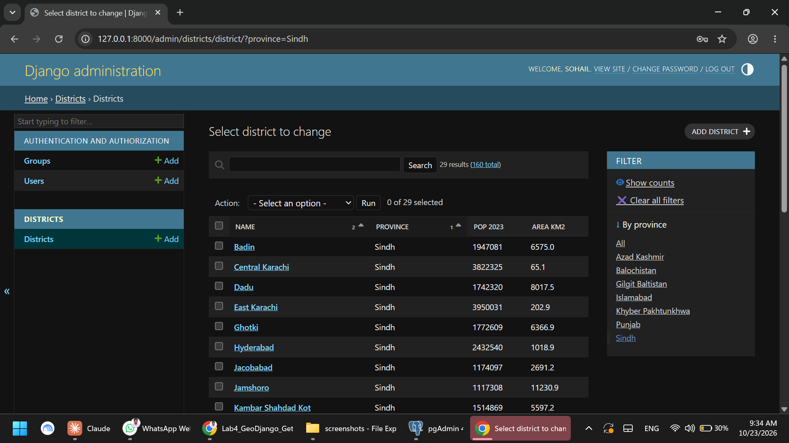

Searching `karachi` gives six districts (Central, East, Korangi, Malir, South, West). Sorting by population puts Harnai (127,571) first.

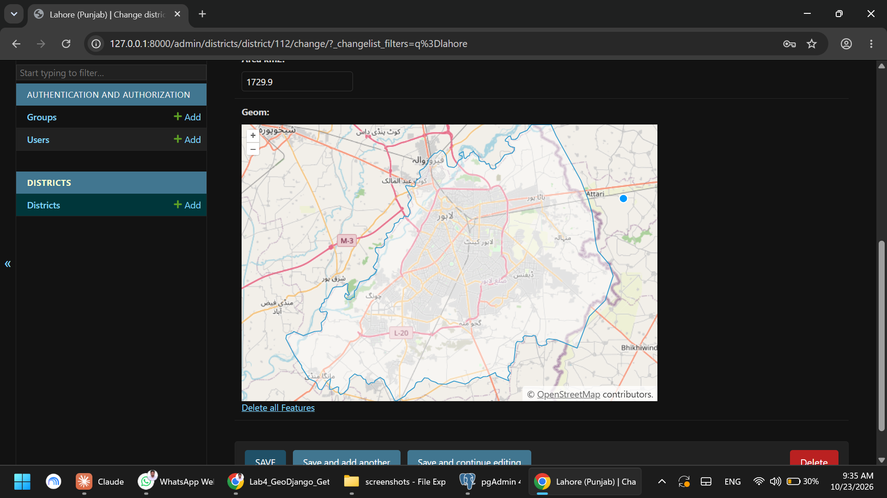

I changed Lahore's population to 13,500,000 and saved. The database followed:

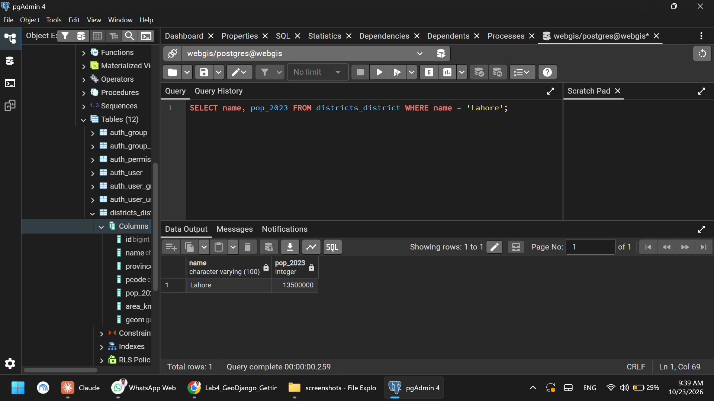

I then set it back to 13,004,135. The History page lists both edits:

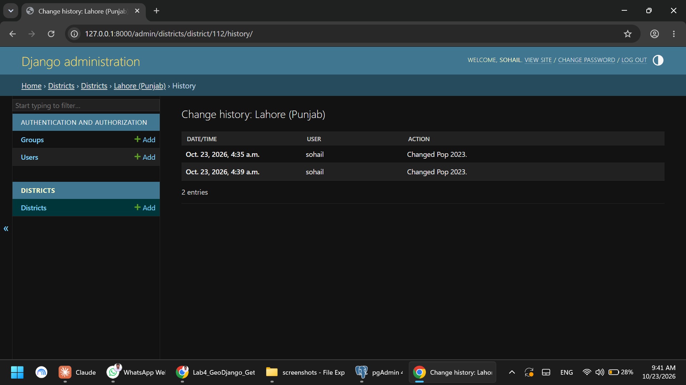

### Checkpoint 7 – Leaflet fed by Django
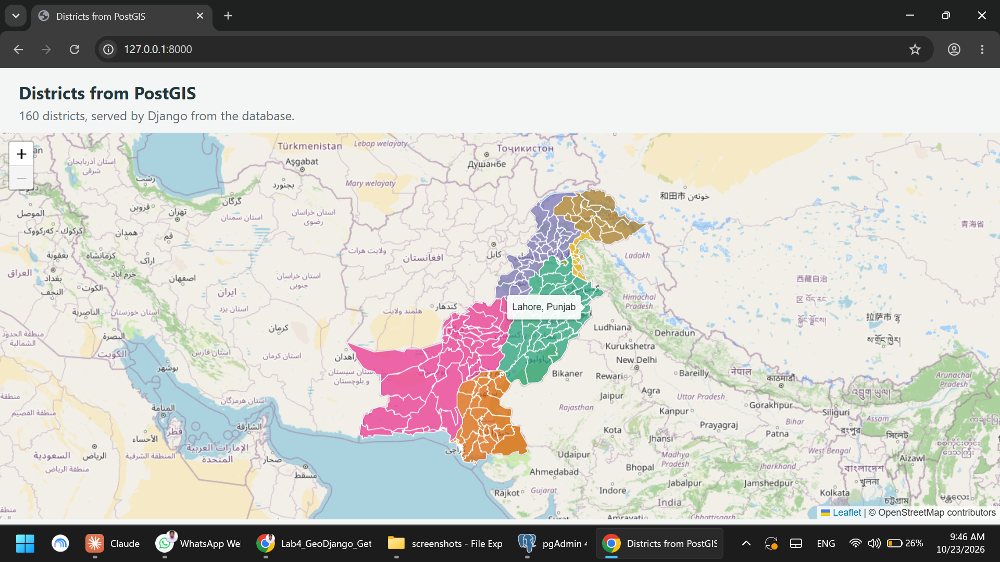

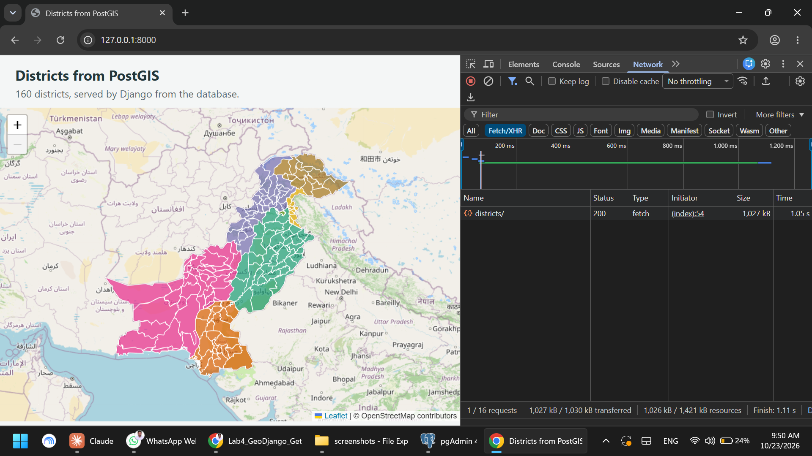

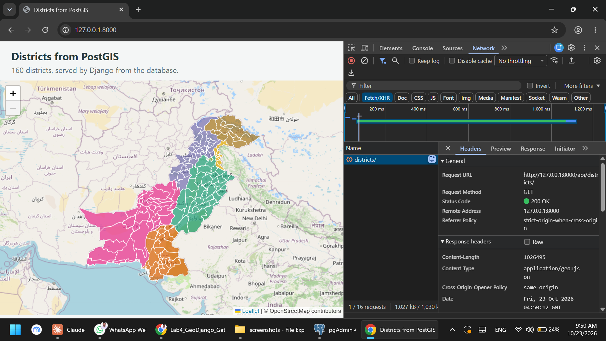

| URL | Features | Size |
|---|---|---|
| `/api/districts/` | 160 | 1,026,495 B (1.05 s in DevTools) |
| `/api/districts/?province=Sindh` | 29 | 173,769 B |
| `/api/districts/?province=Punjab` | 36 | 321,613 B |

### Checkpoint 8 – A spatial question for PostGIS (extension)
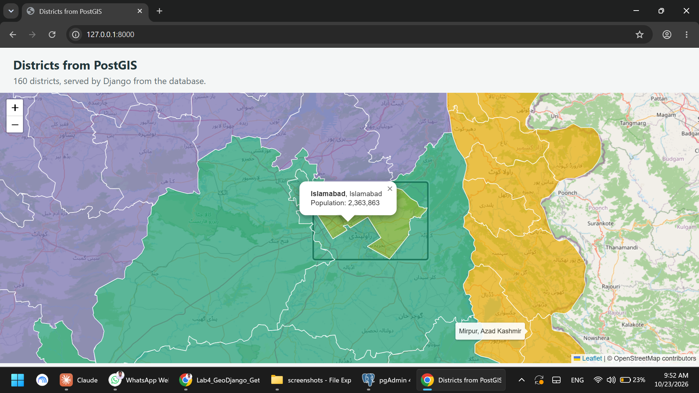

`/api/where/?lat=33.6423&lng=72.9906` answers `{"district": "Islamabad", "province": "Islamabad", "pop_2023": 2363863}`. A point in the sea gives `{"district": null}`, and a non-number gives status 400.

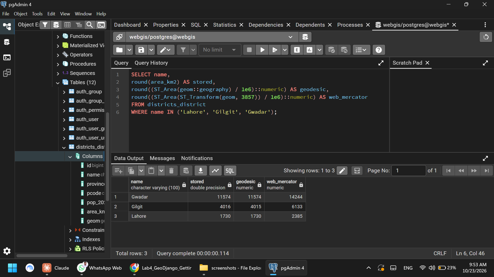

| District | Stored km² | Geodesic km² | Web Mercator km² | Web Mercator ÷ geodesic | 1 ÷ cos²(latitude) | Latitude |
|---|---|---|---|---|---|---|
| Gwadar | 11,574 | 11,574 | 14,244 | 1.231 | 1.225 | 25.4° N |
| Lahore | 1,730 | 1,730 | 2,385 | 1.379 | 1.375 | 31.5° N |
| Gilgit | 4,016 | 4,015 | 6,133 | 1.528 | 1.524 | 35.9° N |

The stored and geodesic areas agree. Web Mercator inflates area by about 1/cos²(latitude), so the further north, the bigger the error.

## 2. Versions

| Item | Version |
|---|---|
| Python | 3.14.7 (python.org) |
| pip | 26.2.1 |
| Django | 6.1.2 |
| psycopg, psycopg-binary | 3.3.6 |
| PostgreSQL | 18.3 |
| PostGIS | 3.6.2 (with GEOS 3.14.1dev, PROJ 8.2.1) |
| pgAdmin 4 | 9.12 |
| GDAL, GEOS, PROJ for Django (OSGeo4W) | 3.13.3, 3.15.0, 9.8.1 |
| Windows | 11 Enterprise, 10.0.26200 |
| Browser | Chrome 155.0.8059.85 |

## 3. What went wrong

| Problem | Message or symptom | Fix |
|---|---|---|
| Drive C: was 94% full | 7.6 GB free of 122 GB | OSGeo4W went to `D:\OSGeo4W` and the virtual environment to D:. `settings.py` reads `OSGEO4W_ROOT` and defaults to the manual's `C:\OSGeo4W`. |
| Python came from the Microsoft Store | 3.13.14, which the manual advises against | Installed Python 3.14.7 with `winget`, rebuilt the virtual environment from `requirements.txt` |
| Wrong database password | `psql: error: connection to server at "localhost" (::1), port 5432 failed: fe_sendauth: no password supplied`, then `FATAL:  password authentication failed for user "postgres"` | Put the right password in the `WEBGIS_DB_PASSWORD` environment variable. It is not in any file. |
| GDAL data folder | The manual's `\share\gdal` does not exist in GDAL 3.13 | `GDAL_DATA` points to `\apps\gdal\share\gdal` |
| Two PROJ installations | `PROJ: proj_create: C:\Program Files\PostgreSQL\18\share\contrib\postgis-3.6\proj\proj.db contains DATABASE.LAYOUT.VERSION.MINOR = 2 whereas a number >= 6 is expected. It comes from another PROJ installation.` | PostGIS sets `PROJ_LIB` for the whole machine. The settings block overwrites `PROJ_LIB` and `PROJ_DATA` inside the Django process. |
| OpenStreetMap blocked every tile | Each tile showed "Access blocked: App is not following the tile usage policy of OpenStreetMap's volunteer-run servers", although the HTTP status was 200 (the picture is 6,987 B, a real tile 13–28 kB) | Django sends `Referrer-Policy: same-origin`, so the browser sent no Referer to OpenStreetMap. Fixed with `SECURE_REFERRER_POLICY = 'strict-origin-when-cross-origin'` in `settings.py`. |

## 4. Questions

**1. In Labs 2 and 3, every visitor downloaded the whole GeoJSON file. What can a page backed by Django and PostGIS do instead? Give two examples from this lab.**
It can send only what is asked for. `/api/districts/?province=Sindh` returns 173,769 B instead of 1,026,495 B, because PostGIS filters first. `/api/where/` sends a 70-byte answer for a clicked point, so the browser never has to test geometry itself. The data can also be edited and checked in one place.

**2. Why does `settings.py` read the database password from an environment variable, instead of containing the password itself?**
`settings.py` is committed to a public GitHub repository, so a password in it would be public. An environment variable stays on the machine, and each person can use their own value without changing the code.

**3. In Part 4, the SQL ends with an index created `USING GIST`. What does it do, and which query in this lab benefits from it?**
A GiST index stores the bounding boxes of the geometries in a tree, so PostGIS can skip every district whose box does not contain the point. The `geom__contains` query behind `/api/where/` uses it: `EXPLAIN` shows `Index Scan using districts_district_geom_4bac833c_id`.

**4. The loading script wraps some geometries in a MultiPolygon. What would happen without that step, and why?**
GeoDjango would stop at the first single polygon with `TypeError: Cannot set District SpatialProxy (MULTIPOLYGON) with value of type: <class 'django.contrib.gis.geos.polygon.Polygon'>`, because the field accepts only multipolygons. PostGIS itself would have taken it, since it promotes single geometries to multi ones; the check is in Django.

**5. Who should have an admin login for a district dataset like this, and who should not?**
Only the few people who maintain the data, each with the least rights they need. Anyone who can log in can change or delete every row. The public and ordinary users should not. The second user in Additional Task 3 can change districts but not delete them.

**6. Leaflet takes `[lat, lng]` and `Point` takes `(lng, lat)`. Where in this lab is each order used, and how does the extension's URL avoid confusing them?**
Leaflet uses latitude first in `setView([30.3753, 69.3451], 5)` and in `maxBounds`. GEOS uses longitude first in `Point(lng, lat, srid=4326)` in `district_at`, and PostGIS in `ST_MakePoint(72.9906, 33.6423)`. The URL passes `?lat=…&lng=…` by name, so the view reads each value by its label and cannot swap them.

## 5. Publishing

This project needs Django and a database, so it has no live URL. GitHub Pages serves a static snapshot made with `python manage.py export_static` (the same template and the data from PostGIS), and the card on the landing page links to it. The README in the lab folder lists the steps to run the real app. The database password is not in the repository.

---

## Additional Task – optional exercises from the manual

### 1. A province drop-down that asks the database
The drop-down calls `/api/districts/?province=…`, so PostGIS does the filtering. **Check:** choosing Sindh sent `districts/?province=Sindh` and received 174 kB in 262 ms, against 1,027 kB in 1.23 s for all districts.

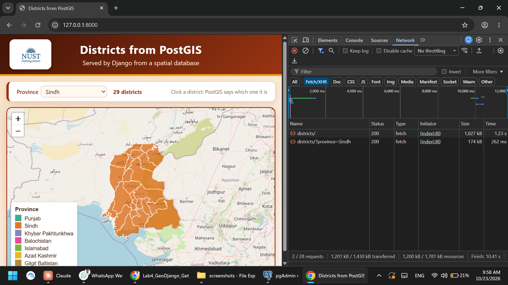

### 2. A `Facility` model with a `PointField`
`Facility` (name and a point) is registered in the admin, whose map opens on Pakistan. I added three facilities by clicking on that map. **Check:** each point lies in the expected district (NUST, Islamabad → Islamabad; Minar-e-Pakistan → Lahore; Mazar-e-Quaid → East Karachi).

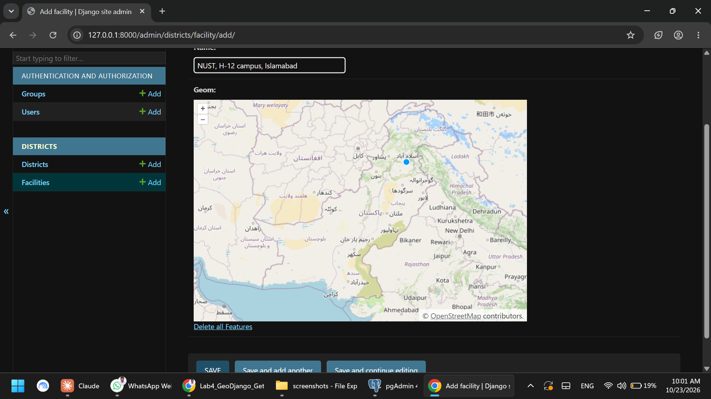

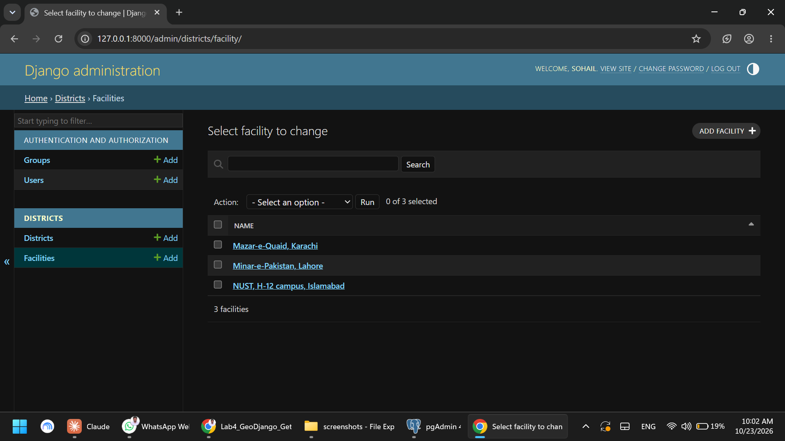

### 3. A second admin user who can change but not delete
The user `editor` has only "Can change district" and "Can view district".

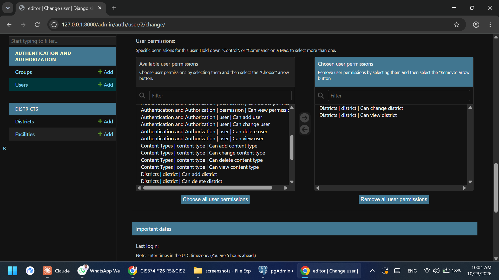

**Check, logged in as `editor`:** the menu shows only Districts, no bulk-delete action is offered, saving works, the form has no Delete button, and `/admin/districts/district/16/delete/` returns 403 Forbidden.

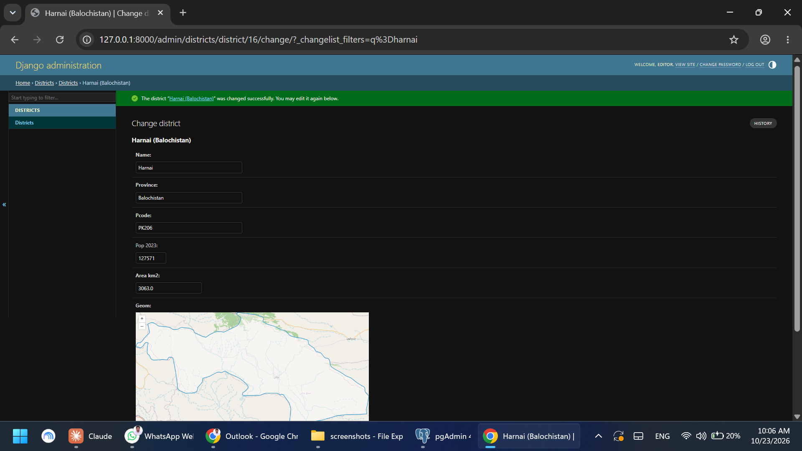

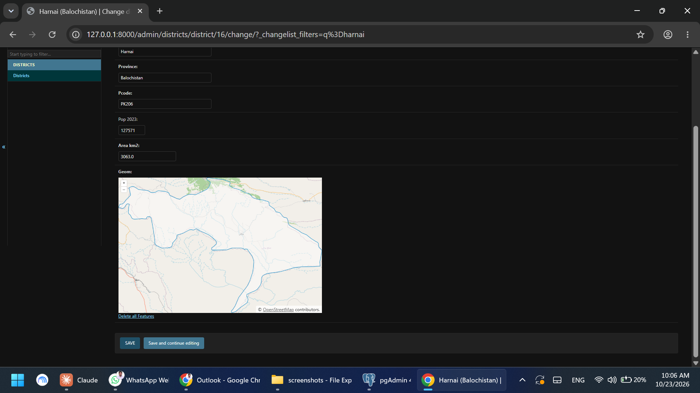

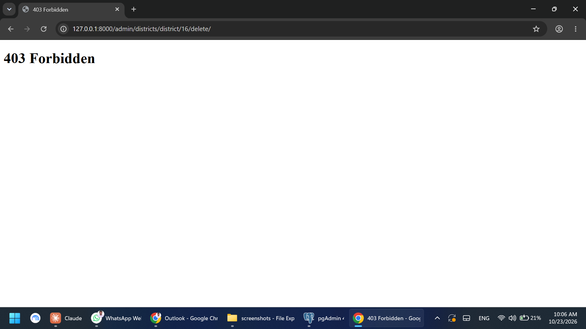

### 4. Grey for districts without census data
Districts whose `pop_2023` is null are drawn grey and have a legend entry. **Check:** 160 districts, 25 grey, and the tooltip adds "(no census data)".

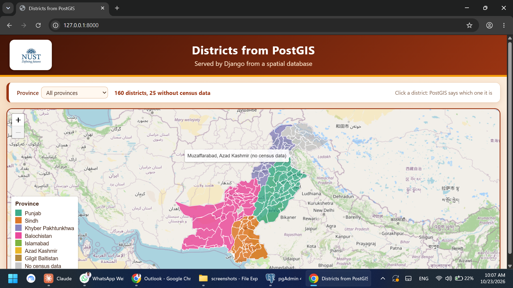

### 5. A static snapshot on GitHub Pages
`export_static` renders the page and the data to `web/`. In the snapshot the province filter and the click answer run in the browser instead of PostGIS. **Check:** Punjab shows 36 districts and a click on Lahore reads 13,004,135, the same as the live app.

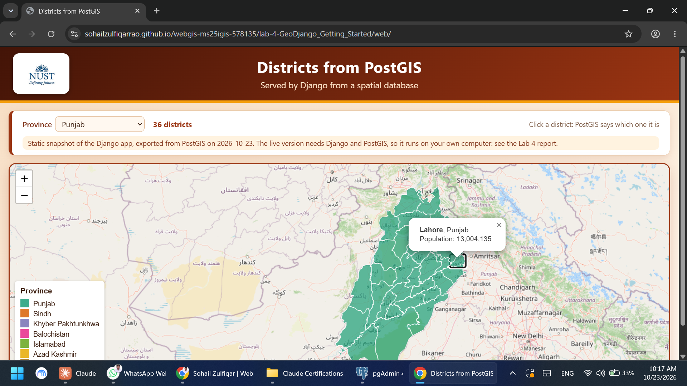
