# Web GIS Lab 5 – A Spatial API: Report

| | |
|---|---|
| **Name** | Sohail Zulfiqar |
| **Registration ID** | 578135 |
| **Email** | szulfiqar.ms25igis@student.nust.edu.pk |
| **Program** | MS GIS & RS – 2025 |
| **Subject** | Web GIS (Dr. Shahid Nawaz Khan) |
| **Repository** | https://github.com/sohailzulfiqarrao/webgis-ms25igis-578135 (folder `lab-5-Spatial_API`) |
| **Map snapshot** | https://sohailzulfiqarrao.github.io/webgis-ms25igis-578135/lab-5-Spatial_API/web/ (a read-only copy; the app itself runs locally) |

## 1. Checkpoint screenshots

### Checkpoint 1 – The project, the libraries and the districts
```
pip freeze
asgiref==3.12.1
Django==6.1.2
django-filter==26.2
djangorestframework==3.18.3
djangorestframework-gis==1.3.0
psycopg==3.3.6
psycopg-binary==3.3.6
sqlparse==0.6.0
tzdata==2026.5

python manage.py shell -c "print(District.objects.count())"
160
```
The project is the Lab 4 folder copied without its environment (`robocopy … /E /XD venv __pycache__`), with a new virtual environment on drive D:. The same `webgis` database is used, so nothing had to be loaded.

### Checkpoint 2 – A first API
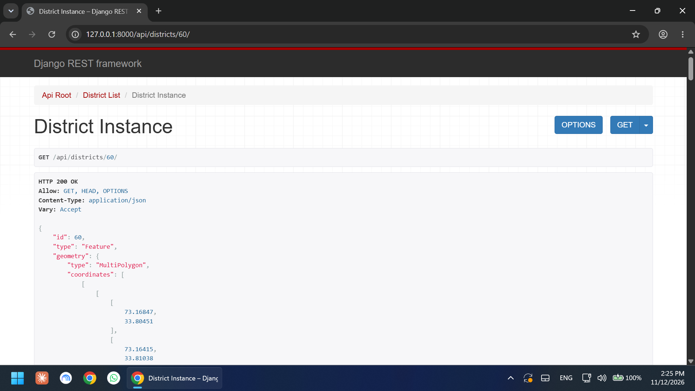

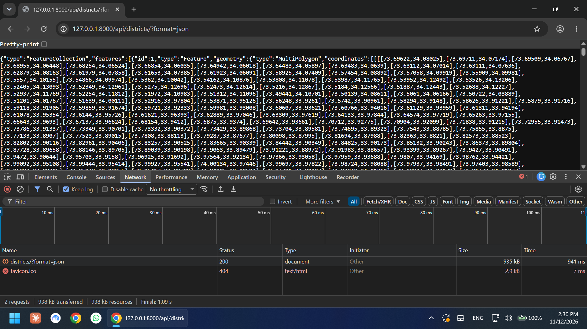

`/api/districts/?format=json` is a FeatureCollection of 160 features: 934,929 B in the body, 935 kB and 941 ms in DevTools.

### Checkpoint 3 – Ask only for what you can see
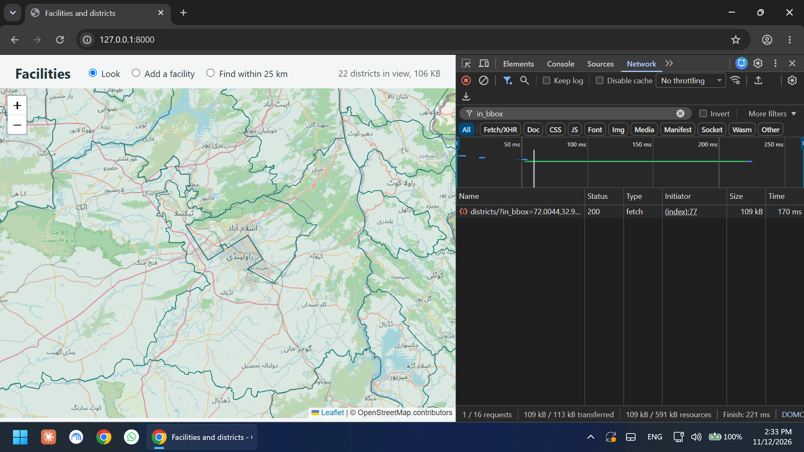

| View | Districts | Size |
|---|---|---|
| `/api/districts/?format=json`, everything | 160 | 934,929 B |
| The map as it opens, Islamabad at zoom 9 | 22 | 109,233 B |
| Zoomed out to zoom 6 | 125 | 727,301 B |
| Zoomed in on Lahore at zoom 11 | 2 | 14,367 B |

Measured in a maximized Chrome window with DevTools docked on the right, so the map area was 725 × 525 px. The sizes are what DevTools reports as transferred; the status line on the page counts characters and reads 106 KB, 710 KB and 14 KB. Filters tried: `?province=Sindh` returns 29 districts, and `?in_bbox=74.0,31.2,74.7,31.8` returns the four that touch the rectangle around Lahore (Kasur, Lahore, Nankana Sahib, Sheikhupura).

### Checkpoint 4 – A second model: facilities
```
python manage.py sqlmigrate facilities 0001
CREATE TABLE "facilities_facility" ("id" bigint NOT NULL PRIMARY KEY GENERATED BY DEFAULT AS IDENTITY,
  "name" varchar(100) NOT NULL, "kind" varchar(10) NOT NULL, "added" timestamp with time zone NOT NULL,
  "geom" geometry(POINT,4326) NOT NULL);
CREATE INDEX "facilities_facility_geom_ba199118_id" ON "facilities_facility" USING GIST ("geom");
```
Like `districts_district`, the table has a real PostGIS column with a GiST index that GeoDjango added by itself. The type is `POINT` here and `MULTIPOLYGON` there.

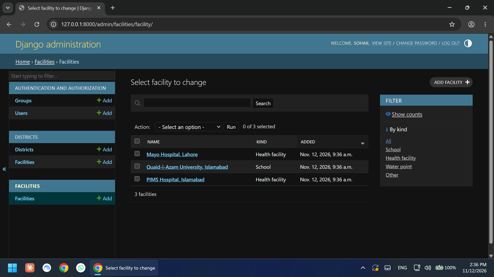

I placed three facilities by clicking on the admin map: PIMS Hospital and Quaid-i-Azam University in Islamabad (both within 25 km of NUST) and Mayo Hospital in Lahore. Lab 4's own `Facility` model (three test points in `districts_facility`) is still there, which is why the admin lists "Facilities" twice. I left it untouched.

### Checkpoint 5 – An API that accepts new points
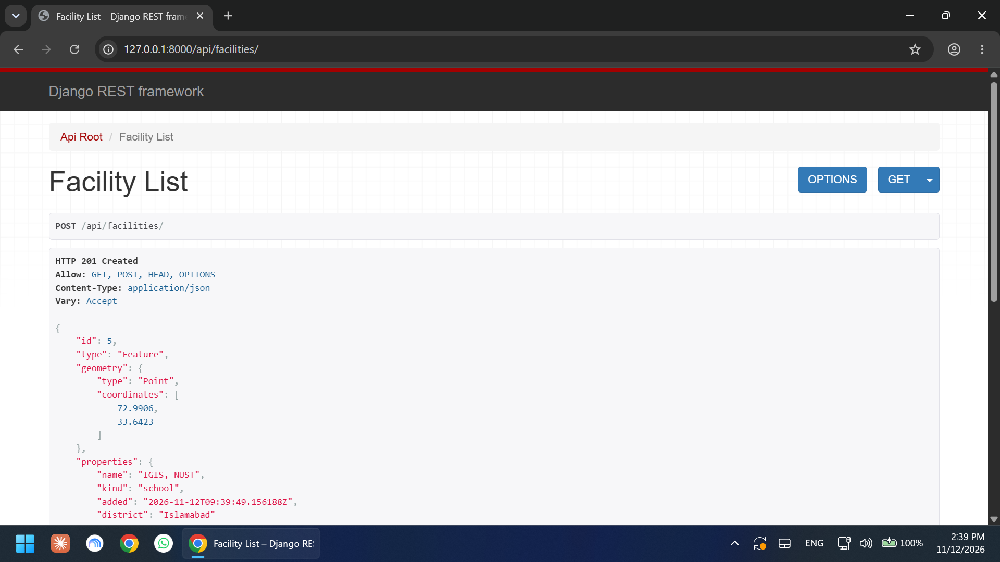

Posting `IGIS, NUST` at `[72.9906, 33.6423]` gave `201 Created` and `"district": "Islamabad"`. (Its id is 5: I had tried the same request once inside a transaction that I rolled back, and a sequence does not roll back.) The three requests that must fail:

| Sent | Answer |
|---|---|
| `[64.0, 23.0]`, the Arabian Sea | `400` `{"geom": ["This point is not inside any district of Pakistan."]}` |
| `"kind": "castle"` | `400` `{"kind": ["\"castle\" is not a valid choice."]}` |
| `[33.6423, 72.9906]`, the NUST coordinates the wrong way round | `400` `{"geom": ["This point is not inside any district of Pakistan."]}` |


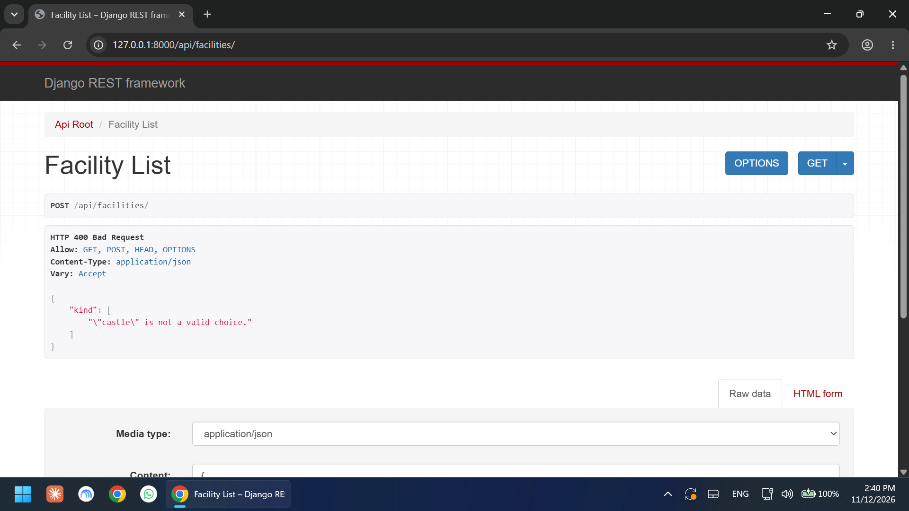

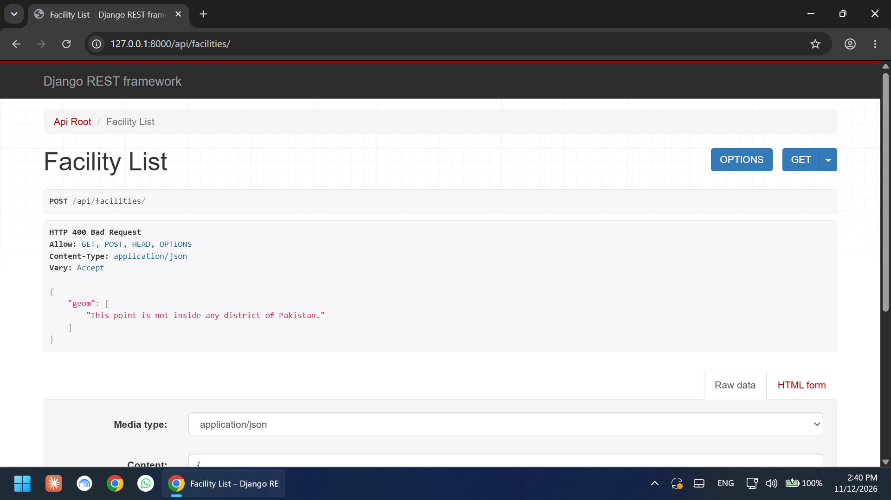

`PUT`, `PATCH` and `DELETE` on `/api/facilities/1/` all answer `405 Method Not Allowed`, as `http_method_names` intends.

### Checkpoint 6 – Collect data from the map
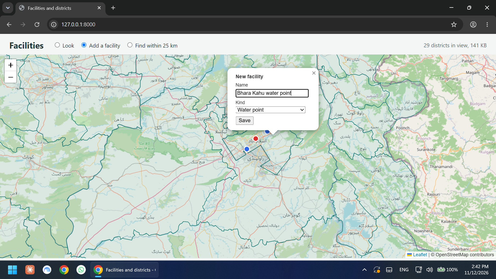

The four tests of Part 6.4:

1. **A point in the Arabian Sea (24.2° N, 67.0° E).** The map does not stop the click (`maxBounds` only limits panning), the form opens, and saving shows the server's message in the form: "This point is not inside any district of Pakistan."
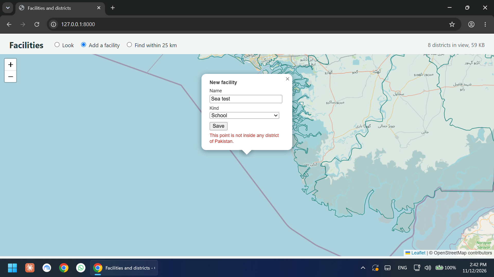
2. **A name that is HTML:** ` Test`. It was saved (in Rawalpindi). The popup shows the name as plain text; there is no `` element in it and no alert.
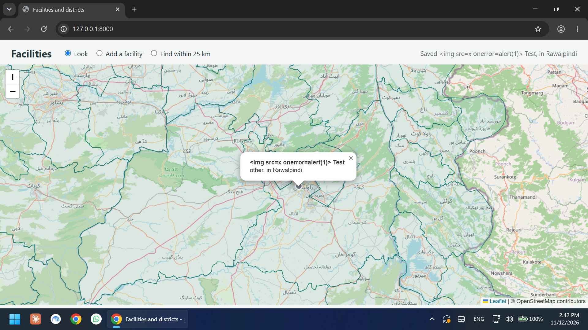
3. **`escapeHtml(p.name)` changed to `p.name`.** Opening the same popup created the image, it failed to load, and `alert(1)` ran ("127.0.0.1:8000 says 1"). Afterwards the popup has lost the text. I put `escapeHtml` back.
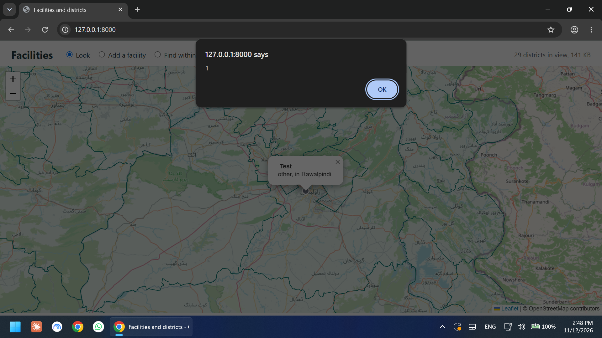
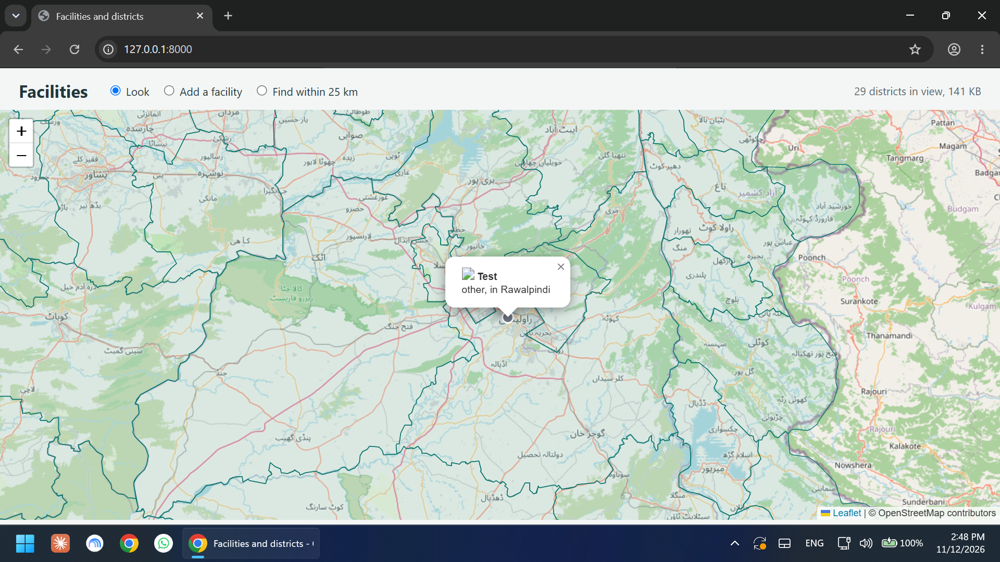
4. **Logged in to the admin in another tab.** With the `X-CSRFToken` header, adding a facility worked ("Saved Session test, in Islamabad"). With that line deleted, and after reloading, the form showed "CSRF Failed: CSRF token missing." I put the line back.
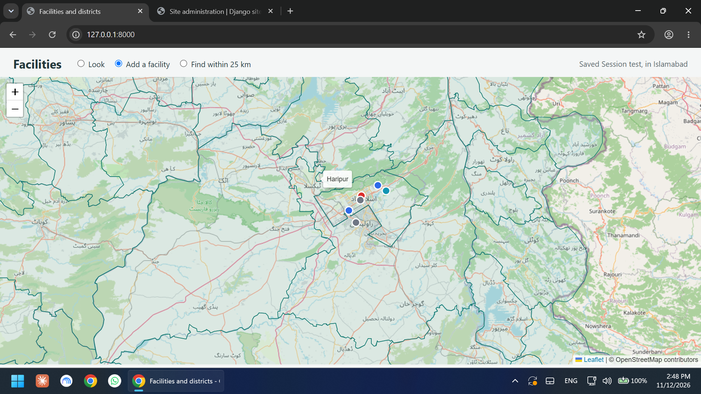
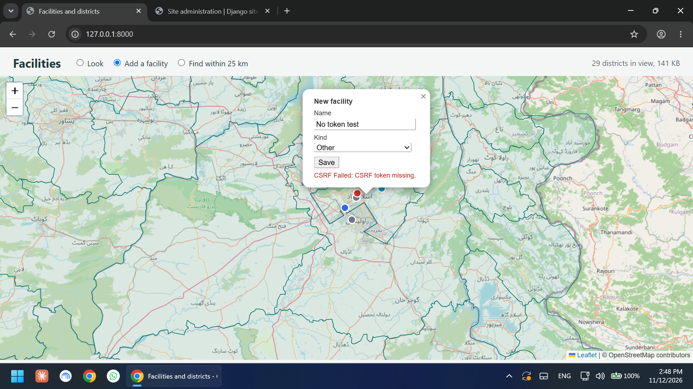

The two rows made by tests 2 and 4 were deleted from the database afterwards. "Bhara Kahu water point", added in the first screenshot, is a real entry and stays.

### Checkpoint 7 – Find facilities within 25 km (extension)
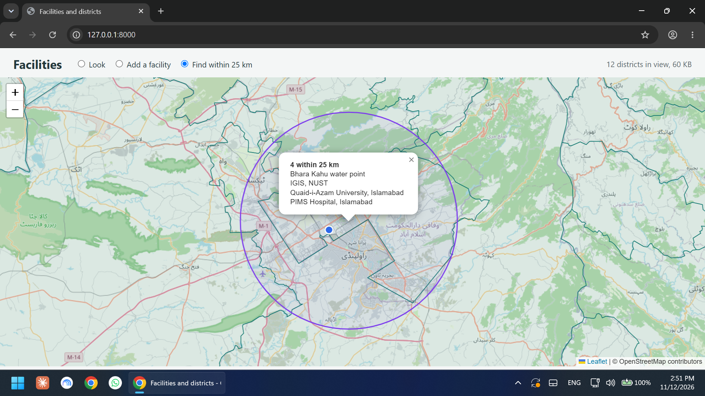

The click was at 73.04° E, 33.66° N, so the request was `/api/facilities/?dist=25000&point=73.04,33.66`, and four facilities came back. Their distances on the ground from that point:

| Facility | Great-circle distance | In the 25 km list |
|---|---|---|
| IGIS, NUST | 4,978 m | yes |
| PIMS Hospital, Islamabad | 5,036 m | yes |
| Quaid-i-Azam University, Islamabad | 13,276 m | yes |
| Bhara Kahu water point | 14,589 m | yes |
| Mayo Hospital, Lahore | 261,164 m | no |

Every facility inside the circle is listed and none outside. One more thing I noticed: a click that lands exactly on a facility opens that facility's popup instead of searching, because the markers have `bubblingMouseEvents: false`. Clicking next to it works.

**The filter is approximate.** `distance_filter_convert_meters` turns metres into degrees by averaging the latitude and longitude conversion (the library's own comment says "there's no good single-valued answer"), and `dwithin` then draws a circle in degrees. At 33.6° N that is an ellipse on the ground, about 27.3 km north to south and 22.7 km east to west for "25 km". I compared the API with great-circle distances at several radii around NUST (72.9906, 33.6423), where Bhara Kahu is 19,582 m away:

| `dist` | API | Great circle | |
|---|---|---|---|
| 5, 10, 17, 19 km | 1, 2, 2, 3 | 1, 2, 2, 3 | same |
| 20 km | 3 | 4 | the API leaves out Bhara Kahu, 19.6 km away |
| 25, 100, 300 km | 4, 4, 5 | 4, 4, 5 | same |

For exact distances the query would have to run on the spheroid (a `Distance` annotation, or a cast to `geography`).

## 2. Versions

| Item | Version |
|---|---|
| Python | 3.14.7 (python.org) |
| pip | 26.2.1 |
| Django | 6.1.2 |
| Django REST Framework | 3.18.3 |
| djangorestframework-gis | 1.3.0 (not yet listed as tested for Django 6.1 and Python 3.14; everything here ran without a problem) |
| django-filter | 26.2 |
| psycopg, psycopg-binary | 3.3.6 |
| PostgreSQL | 18.3 |
| PostGIS | 3.6.2 |
| GDAL, GEOS, PROJ for Django (OSGeo4W) | 3.13.3, 3.15.0, 9.8.1 |
| Windows | 11 Enterprise, 10.0.26200 |
| Browser | Chrome 157.0.8103.50 |

## 3. What went wrong

| Problem | Message or symptom | Fix |
|---|---|---|
| Drive C: still nearly full | 3.8 GB free | The virtual environment is on D:. `settings.py` is unchanged and reads `OSGEO4W_ROOT`. |
| Two "Facilities" in the admin | Lab 4's `districts.Facility` and the new `facilities.Facility` | Left as they are: different apps, different tables, and the Lab 4 rows are still evidence for that lab. |
| The map did not stop a click in the sea | The form opened and the server refused it | The server check is the real protection (question 3). |
| The 25 km filter is not a circle | A facility 19.6 km away is missing at `dist=20000` | See Checkpoint 7. At 25 km every result was right. |
| Slow facility list | 9,964 facilities took 24.9 s | `get_district` runs one query per facility. See Additional Task 1 and question 2. |

## 4. Questions

**1. From your Part 3 table: why does loading by view save so much at zoom 9 and so little at zoom 6? What would help at the scale of the whole country?**
At zoom 9 the view is about 2° wide and touches 22 districts, so the request is 109 kB instead of 935 kB. At zoom 6 the view covers most of Pakistan: 125 of 160 districts and 727 kB, a saving of only 22%. At that scale the problem is not the number of districts but the detail of each one: the boundaries keep about a metre of precision, far more than a map at zoom 6 can show. Simplified copies of the boundaries for low zoom levels (`ST_SimplifyPreserveTopology`), or vector tiles that PostGIS cuts for each zoom (`ST_AsMVT`), would send far fewer vertices.

**2. The facility's district is worked out each time it is sent, instead of being stored. Give one advantage and one cost.**
Advantage: it can never be out of date. If a boundary changes, the next answer is right without updating any row, and there is no extra column to keep in step. Cost: a spatial query for every facility, every time. For 9,964 facilities the full list took 24.9 s, about 2.5 ms each, while a view with 211 facilities took 1 s. A join in one query, a cache, or a stored value refreshed when boundaries change would fix it.

**3. The map already stops you clicking in the sea, so why must the server check the point as well?**
In this page the map does not really stop it (the form opened in the sea), but even if it did, the browser is not the only client. Anyone can send a POST with the browsable API, `curl` or a script, and nothing in a browser can be trusted by the server. The server check is also what caught the swapped coordinates in Part 5, which the map could not know about.

**4. Why did posting fail only after you logged in to the admin?**
Django REST Framework checks the CSRF token only for requests that are authenticated by a session. An anonymous visitor is not, so the post worked without the header. After the admin login the browser sends the session cookie with every request, the request counts as a logged-in one, and without the `X-CSRFToken` header the answer is `CSRF Failed: CSRF token missing.`

**5. What happened in step 3 of Part 6.4, and who would it affect on a real site?**
Without `escapeHtml`, the name went into the popup as HTML. The `` tag was created, `src=x` failed to load, and the `onerror` code ran: `alert(1)`. That is cross-site scripting. The code runs in the browser of everyone who opens that facility's popup, with that person's rights on the site, so it could read their session or act as them. On a real site that includes every visitor and any logged-in administrator.

**6. What must exist before this API can safely allow DELETE?**
Logins, so the server knows who is asking (Lab 6), and permissions, so that only allowed people can delete (the owner, or staff). On top of that: HTTPS so the session cannot be read on the way, the CSRF token on every change, and ideally a record of who deleted what, or a "deleted" flag instead of removing rows.

## 5. Publishing

This project needs Django and a database, so it has no live URL. GitHub Pages serves a read-only snapshot made with `python manage.py export_static`: the same page, with the data that the API sends (districts with `facilities_count`, and the facilities with their district). In the snapshot the three questions the page asks the API (view, kind, distance) are answered in the browser instead of PostGIS, and the add form explains that it is read-only. The card on the landing page links to it, and the README in the lab folder lists the steps to run the real app. The database password is not in the repository.

---

## Additional Task – optional exercises from the manual

To give the menu and the shading something to show, I added 14 well-known places across the provinces (hospitals, universities, the Minar-e-Pakistan, a lake) through the API itself. Their positions are approximate, to about a kilometre. With the five from the checkpoints there are 19 facilities: 9 health, 6 school, 2 water, 2 other.

At the end of the lab I replaced the plain circle markers with pins: a coloured disc with a white ring and a halo and a symbol of its kind inside (a cross for health, a mortarboard for schools, a drop for water, a star for the rest). The screenshots in this report were taken before that change and show the circles; the snapshot and the landing page card show the pins. Pins are HTML elements, so when more than 500 facilities are in view (the 10,000-point test at zoom 6 had 3,959) the map draws small plain dots instead, and the pins return as you zoom in. The info windows are tables too: one facility shows its kind, district, date added and position, and the nearby search shows a ranked table (facility, kind, distance). The table sorts the results by the distance on the ground that it computes, so a rank and a distance never disagree, even though the API's own order is by degrees (Additional Task 4). Opening a taller popup makes the map pan, so the facilities now keep the markers that stay in view instead of redrawing all of them; otherwise the redraw closed the popup.

### 1. Load the facilities by view too
The facilities now ask for `?in_bbox=…` on every move, with the same "cancel the old request" pattern as the districts, and the status line reports both answers. **Check, with 9,964 facilities** (the 5 real ones plus 9,959 random points inside the real districts, named "Load test N" and deleted afterwards): the old page fetched everything, 2,228 kB in 23.12 s, and drew 9,964 markers. The new page asks for `facilities/?in_bbox=72.0731,33.1192,73.9243,34.0800`: 47.5 kB in 1.04 s, 211 markers.

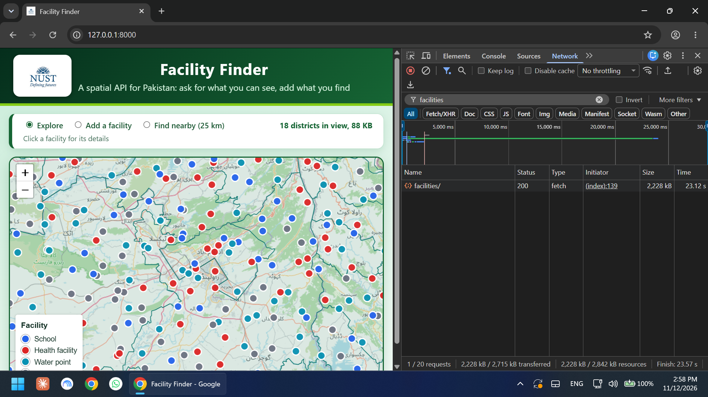

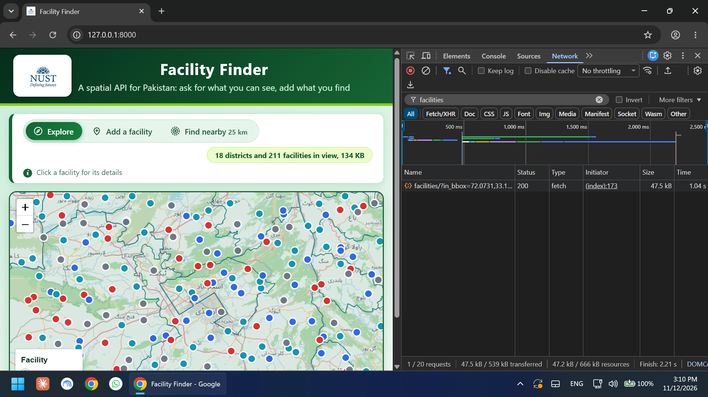

| View | Facilities | Size and time |
|---|---|---|
| Opening view, zoom 9 | 215 | 48 kB, 0.5 s |
| Lahore, zoom 11 | 15 | 3.7 kB, 0.08 s |
| Zoomed out to zoom 6 | 4,651 | 1,046 kB, 5.9 s |

At zoom 6 the answer is still a megabyte, the same problem as in question 1: loading by view helps until the view is the whole country. Clustering or tiles would be the next step.

### 2. A menu that filters by kind
The "Show" menu adds `&kind=health` and so on to every facility request, and to the nearby search. PostGIS does the filtering through `django-filter`. **Check:** the whole country shows 19 facilities; choosing "Health facilities" sent `/api/facilities/?in_bbox=42.4951,22.1467,96.5039,38.0308&kind=health` and 9 facilities came back, all of kind health.

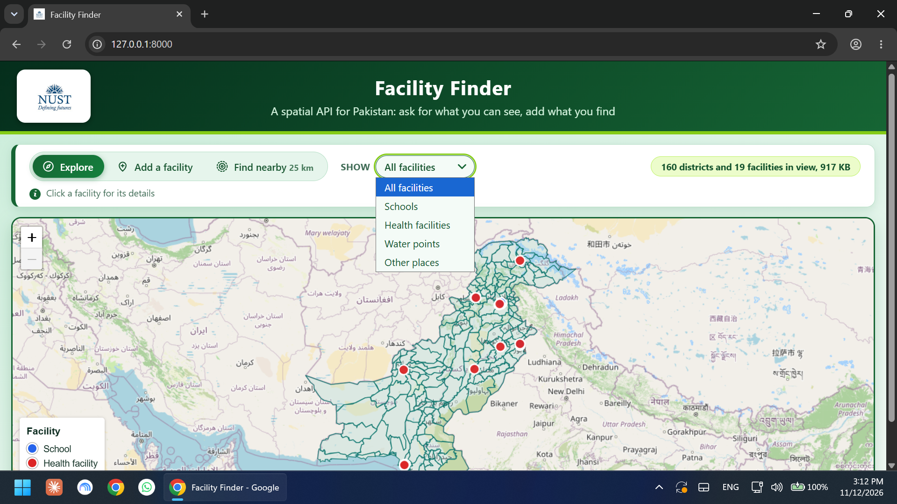

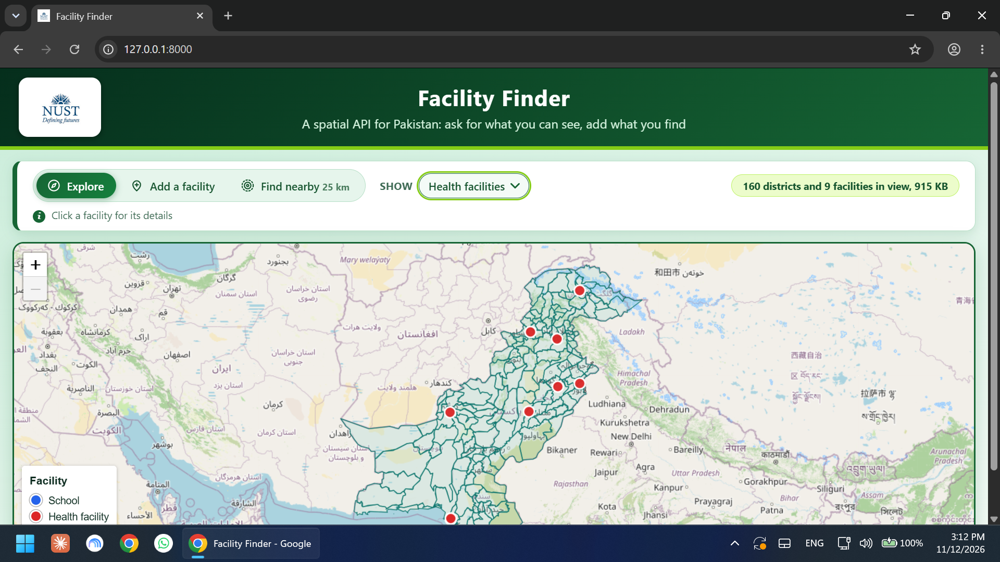

### 3. A facility count per district, and shading by it
`DistrictViewSet` adds `facilities_count` with `annotate` and `Count`. A facility belongs to a district by position, not by a foreign key, so the `Count` runs in a subquery over `geom__within=OuterRef("geom")`. **Check:** one query for all 160 districts, 19 facilities counted in total in 9 districts (Islamabad 5, Lahore 4, East Karachi 3, Peshawar 2), and no difference from an independent count made district by district. The switch "Shade districts by facility count" colours the districts in four classes (none, 1, 2 to 3, 4 or more) with its own legend, the tooltip reads "Lahore · 4 facilities", and adding a facility reloads the districts so that the count goes up.

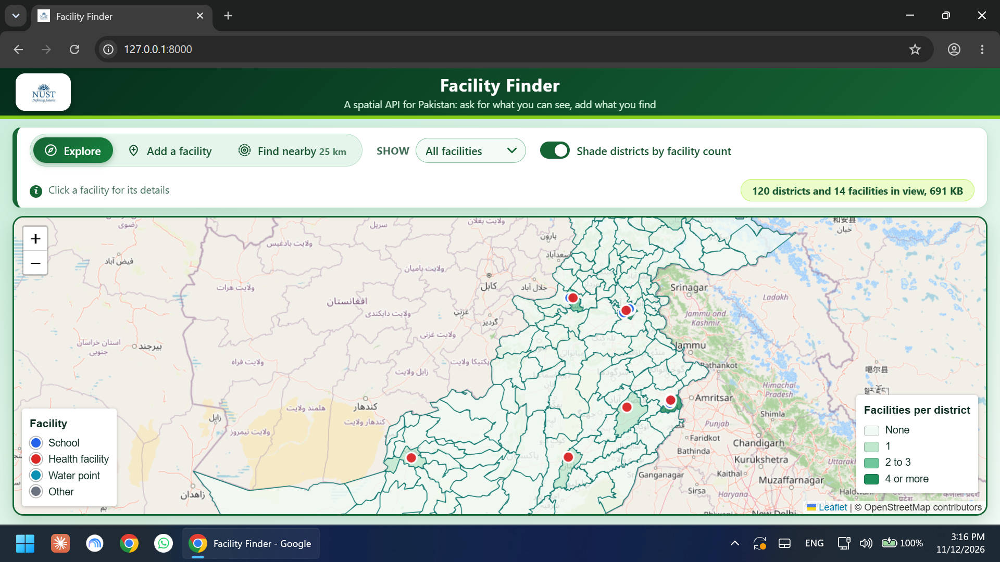

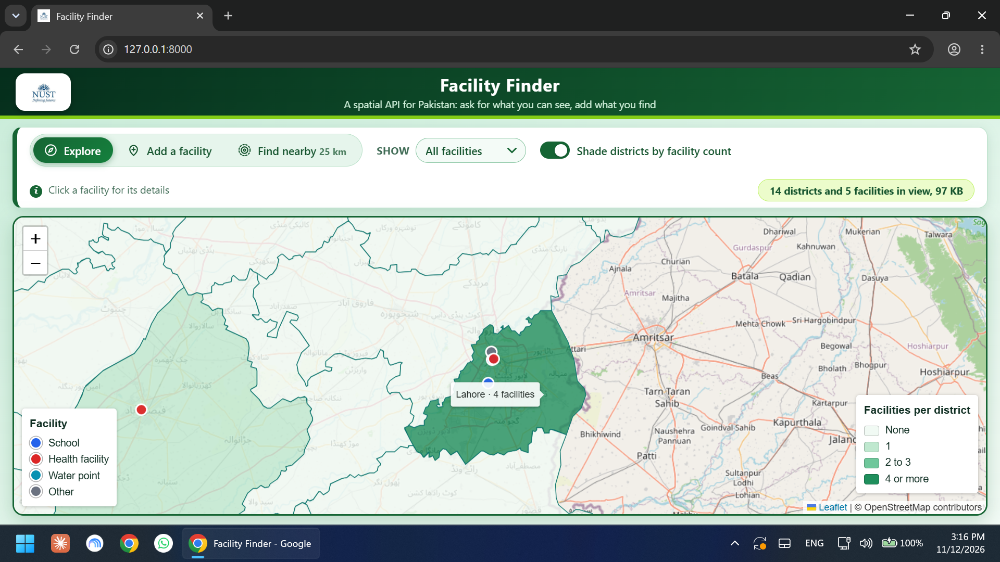

### 4. Nearest first
`DistanceToPointOrderingFilter` is added to the facility viewset (`distance_ordering_filter_field = "geom"`), so `?dist=25000&point=…` returns the nearest first and `&order=desc` reverses it. The popup shows each distance in kilometres, worked out in the browser with `LatLng.distanceTo`. **Check:** from 73.04° E, 33.66° N the order was PIMS Hospital 4.8 km, IGIS NUST 4.9 km, Rawal Lake 8.7 km, Quaid-i-Azam University 13.2 km, Bhara Kahu 14.7 km. The ordering is done on distance in degrees, so it is not always the true order: with 300 random query points and a 100 km radius, 31 had two or more results, and in 6 of them the order differed from the distance on the ground.

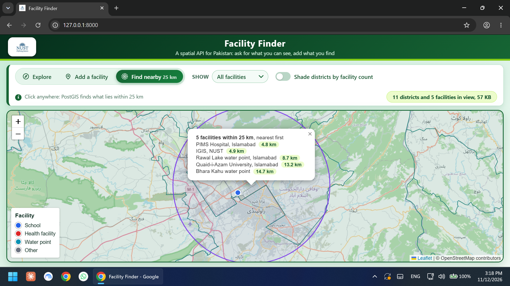
